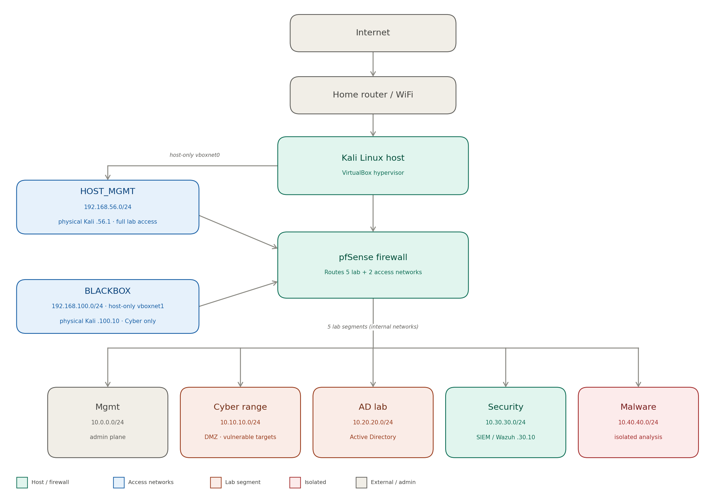
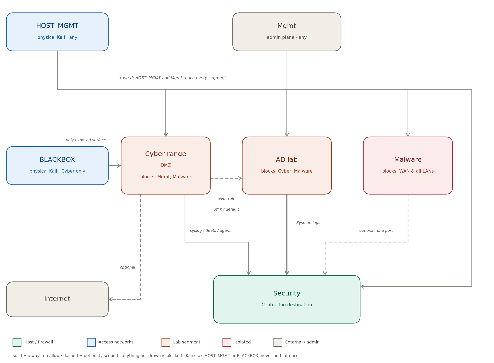

# Home Cybersecurity Lab — Enterprise Firewall & Network Segmentation Build Documentation

A production-grade, segmented VirtualBox-based home lab built on a physical Kali Linux host, providing a realistic environment for penetration testing, Active Directory security, SOC/detection engineering, and malware analysis — all strictly isolated behind a 7-interface pfSense enterprise firewall.

---

## Table of Contents

- [Home Cybersecurity Lab — Enterprise Firewall \& Network Segmentation Build Documentation](#home-cybersecurity-lab--enterprise-firewall--network-segmentation-build-documentation)
  - [Table of Contents](#table-of-contents)
  - [1. Architecture Overview](#1-architecture-overview)
    - [1.1 Lab Architecture Diagram](#11-lab-architecture-diagram)
    - [1.2 Network Subnet \& Interface Design](#12-network-subnet--interface-design)
    - [1.3 Core Hosts \& Addressing](#13-core-hosts--addressing)
  - [2. Recommended Build Order](#2-recommended-build-order)
  - [3. Physical Host Setup (Kali Linux)](#3-physical-host-setup-kali-linux)
    - [3.1 Hypervisor Installation](#31-hypervisor-installation)
    - [3.2 Host Security Recommendation](#32-host-security-recommendation)
  - [4. VirtualBox Virtual Networking](#4-virtualbox-virtual-networking)
    - [4.1 Internal Networks (Lab LAN Segments)](#41-internal-networks-lab-lan-segments)
    - [4.2 Host-Only Network (Kali Access Link)](#42-host-only-network-kali-access-link)
    - [4.3 Whitelisting Host-Only Subnet](#43-whitelisting-host-only-subnet)
  - [5. pfSense — Router \& Enterprise Firewall](#5-pfsense--router--enterprise-firewall)
    - [5.1 VM Sizing \& Provisioning](#51-vm-sizing--provisioning)
      - [Automated Provisioning via CLI](#automated-provisioning-via-cli)
    - [5.2 Interface Assignment \& Mapping Reference](#52-interface-assignment--mapping-reference)
    - [5.3 Stateful Filtering Principles \& Ingress Evaluation](#53-stateful-filtering-principles--ingress-evaluation)
    - [5.4 Firewall Rule Matrices Per Interface](#54-firewall-rule-matrices-per-interface)
      - [1. Management Interface (`MGMT` / `em1`)](#1-management-interface-mgmt--em1)
      - [2. Cyber Range Interface (`CYBER` / `em2`)](#2-cyber-range-interface-cyber--em2)
      - [3. Active Directory Interface (`AD` / `em3`)](#3-active-directory-interface-ad--em3)
      - [4. Security Operations Interface (`SECURITY` / `em4`)](#4-security-operations-interface-security--em4)
      - [5. Malware Sandbox Interface (`MALWARE` / `em5`)](#5-malware-sandbox-interface-malware--em5)
      - [6. HOST\_MGMT Interface (`HOST_MGMT` / `em6`)](#6-host_mgmt-interface-host_mgmt--em6)
    - [5.5 Overall Firewall Traffic Flow Diagram](#55-overall-firewall-traffic-flow-diagram)
    - [5.6 Configuration Backup Protocol](#56-configuration-backup-protocol)
    - [5.7 HOST\_MGMT — Trusted Kali Administration Access](#57-host_mgmt--trusted-kali-administration-access)
    - [5.8 Kali Administration Access \& Routing Script (`lab-trusted.sh`)](#58-kali-administration-access--routing-script-lab-trustedsh)
  - [6. Segment 1 — Management Enclave (`10.0.0.0/24`)](#6-segment-1--management-enclave-1000024)
  - [7. Segment 2 — Cyber Range \& DMZ (`10.10.10.0/24`)](#7-segment-2--cyber-range--dmz-101010024)
    - [7.1 Core \& Intermediate Target Workstations](#71-core--intermediate-target-workstations)
    - [7.2 Sysmon Monitoring on Metasploitable 3 (Server 2008 R2)](#72-sysmon-monitoring-on-metasploitable-3-server-2008-r2)
    - [7.3 SafeLine WAF Reverse Proxy Deployment](#73-safeline-waf-reverse-proxy-deployment)
  - [8. Segment 3 — Active Directory Lab (`10.20.20.0/24`)](#8-segment-3--active-directory-lab-102020024)
    - [8.1 Domain Controller \& Forest Setup](#81-domain-controller--forest-setup)
    - [8.2 Client Workstation Join \& Auditing Configuration](#82-client-workstation-join--auditing-configuration)
    - [8.3 Attack Tooling \& Security Exercises](#83-attack-tooling--security-exercises)
  - [9. Segment 4 — Security Monitoring \& SIEM (`10.30.30.0/24`)](#9-segment-4--security-monitoring--siem-103030024)
    - [9.1 Detection Stack \& Architecture](#91-detection-stack--architecture)
    - [9.2 Log Collection \& Ingestion Channels](#92-log-collection--ingestion-channels)
    - [9.3 Hands-On Detection Engineering Scenarios](#93-hands-on-detection-engineering-scenarios)
  - [10. Segment 5 — Malware Analysis Sandbox (`10.40.40.0/24`)](#10-segment-5--malware-analysis-sandbox-104040024)
    - [10.1 Multi-Layered Sandbox Isolation](#101-multi-layered-sandbox-isolation)
    - [10.2 Fake Internet Simulation (INetSim / FakeNet-NG)](#102-fake-internet-simulation-inetsim--fakenet-ng)
    - [10.3 Analysis Tooling \& Golden Image Snapshots](#103-analysis-tooling--golden-image-snapshots)
  - [11. Comprehensive Component \& Download Reference](#11-comprehensive-component--download-reference)
  - [12. Testing \& Validation Procedures](#12-testing--validation-procedures)
    - [12.1 Inter-Segment Connectivity Matrix Validation](#121-inter-segment-connectivity-matrix-validation)
    - [12.2 Service Reachability Checks](#122-service-reachability-checks)
    - [12.3 End-to-End SOC Detection Proof](#123-end-to-end-soc-detection-proof)
    - [12.4 Malware Sandbox Isolation Verification](#124-malware-sandbox-isolation-verification)
    - [12.5 Access Mode Verification](#125-access-mode-verification)
      - [HOST\_MGMT Verification:](#host_mgmt-verification)
  - [13. Master Lab Build Checklist](#13-master-lab-build-checklist)
  - [14. Repository Structure \& Modular Sub-Guides](#14-repository-structure--modular-sub-guides)
  - [License \& Attribution](#license--attribution)

---

## 1. Architecture Overview

### 1.1 Lab Architecture Diagram




**Key Architectural Concept:**
- **Kali Linux is the physical host operating system**, not a virtual machine.
- Oracle VM VirtualBox runs directly on top of Kali and hosts all lab VMs, including pfSense Community Edition.
- pfSense serves as the virtual core router and policy enforcement firewall across **five internal isolated virtual networks** (`intnet-*`).
- The physical Kali host sits **strictly outside** the internal segments. It never attaches directly to any internal network.
- Administrative access is handled via a dedicated host-only adapter (`vboxnet0`), ensuring complete network containment without bridging the host into the internal broadcast domains.

---

### 1.2 Network Subnet & Interface Design

| Network Name    | Interface    | Subnet Range      | pfSense IP      | Attachment Type             | Purpose & Policy                                    |
| :-------------- | :----------- | :---------------- | :-------------- | :-------------------------- | :-------------------------------------------------- |
| **WAN**         | `em0`        | DHCP (NAT)        | Assigned by NAT | VirtualBox NAT              | Upstream Internet access via host Wi-Fi/Ethernet    |
| **Mgmt**        | `em1` (LAN)  | `10.0.0.0/24`     | `10.0.0.1`      | Internal (`intnet-mgmt`)    | Dedicated administrative enclave; pfSense WebGUI    |
| **Cyber Range** | `em2` (OPT1) | `10.10.10.0/24`   | `10.10.10.1`    | Internal (`intnet-cyber`)   | Deliberately vulnerable systems; doubles as lab DMZ |
| **AD Lab**      | `em3` (OPT2) | `10.20.20.0/24`   | `10.20.20.1`    | Internal (`intnet-ad`)      | Windows Domain Controller, forest members, Kerberos |
| **Security**    | `em4` (OPT3) | `10.30.30.0/24`   | `10.30.30.1`    | Internal (`intnet-sec`)     | Centralized monitoring, Wazuh SIEM, log collection  |
| **Malware**     | `em5` (OPT4) | `10.40.40.0/24`   | `10.40.40.1`    | Internal (`intnet-malware`) | Quarantined dynamic detonation; zero WAN egress     |
| **HOST_MGMT**   | `em6` (OPT5) | `192.168.56.0/24` | `192.168.56.2`  | Host-only (`vboxnet0`)      | Trusted physical Kali management path               |

> [!NOTE]
> Device identifiers (`em0`–`em6`) represent default FreeBSD mappings when using Intel PRO/1000 MT adapters (`82540EM` or `82545EM`). Always verify exact interface-to-adapter assignments by checking MAC addresses under pfSense **Interfaces → Assignments**.

---

### 1.3 Core Hosts & Addressing

| Host Name / Role        | Segment          | Assigned IP                  | Description                                                      |
| :---------------------- | :--------------- | :--------------------------- | :--------------------------------------------------------------- |
| **pfSense Firewall**    | Core Gateway     | `10.0.0.1`<br>`192.168.56.2` | Central router, Unbound DNS, stateful packet filter, DHCP server |
| **Management Ubuntu**   | Mgmt             | `10.0.0.10`                  | GUI management workstation for out-of-band administration        |
| **Metasploitable 2**    | Cyber Range      | `10.10.10.10`                | Legacy unpatched Linux target                                    |
| **Metasploitable 3**    | Cyber Range      | `10.10.10.20`                | Windows Server 2008 R2 target running Sysmon telemetry           |
| **SafeLine WAF**        | Cyber Range      | `10.10.10.50`                | Reverse proxy WAF protecting web applications                    |
| **Primary DC (`DC01`)** | Active Directory | `10.20.20.10`                | Windows Server 2022 Domain Controller (`lab.local`)              |
| **Windows Clients**     | Active Directory | `10.20.20.20`, `.30`         | Domain-joined client endpoints                                   |
| **Wazuh / SIEM Host**   | Security         | `10.30.30.10`                | Security Onion / Wazuh Manager, Indexer & Dashboard              |
| **FLARE VM / REMnux**   | Malware          | `10.40.40.10`                | Reverse engineering & behavioral analysis sandboxes              |
| **FakeNet / INetSim**   | Malware          | `10.40.40.20`                | Local simulated Internet service responder                       |
| **Physical Kali Host**  | HOST_MGMT        | `192.168.56.1`               | Trusted administrator on `vboxnet0`                              |

---

## 2. Recommended Build Order

To avoid circular dependencies and having to touch virtual machine network settings multiple times, follow this precise deployment sequence:

```text
┌────────────────────────────────────────────────────────────────────────┐
│                        SEQUENTIAL BUILD PIPELINE                       │
└────────────────────────────────────────────────────────────────────────┘
  1. HOST & NETWORKS  ──> 2. PFSENSE CORE  ──> 3. ACCESS LINKS
            │                     │                   │
            ▼                     ▼                   ▼
  4. MGMT WORKSTATION ──> 5. CYBER RANGE   ──> 6. AD LAB
            │                     │                   │
            ▼                     ▼                   ▼
  7. SECURITY SIEM    ──> 8. MALWARE LAB   ──> 9. VALIDATION
```

1. **Host Setup & Whitelisting**: Install VirtualBox + Extension Pack on Kali Linux and configure `/etc/vbox/networks.conf` (Section 3 & 4.3).
2. **VirtualBox Virtual Networks**: Create the 5 internal networks (`intnet-*`) and 1 host-only network (`vboxnet0`) (Section 4).
3. **pfSense Core Provisioning**: Deploy pfSense with 7 network adapters, install the OS, assign interfaces, set static gateway IPs, and enable DHCP (Section 5.1–5.2).
4. **Access Network Activation**: Set up `HOST_MGMT` rules and verify routing from the physical Kali host (Section 5.7–5.8).
5. **Segment 1 — Management Deployment**: Deploy the Ubuntu Management VM (`10.0.0.10`) on `intnet-mgmt` to administer pfSense via WebGUI (`https://10.0.0.1`) (Section 6).
6. **Segment 2 — Cyber Range Targets**: Deploy Metasploitable 2/3, OWASP Juice Shop, DVWA, and SafeLine WAF on `intnet-cyber` (Section 7).
7. **Segment 3 — Active Directory Lab**: Deploy Windows Server 2022 (`DC01`), promote `lab.local`, join client endpoints, and deploy Sysmon (Section 8).
8. **Segment 4 — Security Monitoring**: Deploy Wazuh / Security Onion on `intnet-sec`, configure pfSense syslog forwarding, and ingest host telemetry (Section 9).
9. **Segment 5 — Malware Analysis**: Build FLARE VM / REMnux with temporary internet access, disconnect to `intnet-malware`, enforce default-deny, and snapshot clean baselines (Section 10).
10. **Testing & Validation**: Execute the full connectivity matrix and SOC alert verification tests (Section 12).

---

## 3. Physical Host Setup (Kali Linux)

The physical workstation runs bare-metal Kali Linux. Because Kali serves as the virtualization hypervisor and primary attack platform, system hygiene is paramount:

### 3.1 Hypervisor Installation

```bash
# Update local package indexes
sudo apt update && sudo apt full-upgrade -y

# Install VirtualBox and DKMS kernel module dependencies
sudo apt install -y virtualbox virtualbox-ext-pack dkms

# Add your current user to the vboxusers group
sudo usermod -aG vboxusers $USER
```

Reboot or log out and back in to ensure group memberships take effect:
```bash
newgrp vboxusers
```

### 3.2 Host Security Recommendation
Treat the physical Kali host as an attack workstation and hypervisor platform, **not as a personal daily-driver workstation**. Conduct web browsing and everyday tasks on a separate machine or isolated environment to prevent exposing host credentials while testing exploits or handling malware.

---

## 4. VirtualBox Virtual Networking

### 4.1 Internal Networks (Lab LAN Segments)

VirtualBox **Internal Networks** create isolated virtual switches that connect guest virtual machines to each other without exposing traffic to the host's physical network adapters.

In VirtualBox: **Tools → Network Manager → Internal Networks** (or dynamically created in VM settings):

| Internal Network Name | Logical Segment   | Subnet          | Gateway      |
| :-------------------- | :---------------- | :-------------- | :----------- |
| `intnet-mgmt`         | Management        | `10.0.0.0/24`   | `10.0.0.1`   |
| `intnet-cyber`        | Cyber Range / DMZ | `10.10.10.0/24` | `10.10.10.1` |
| `intnet-ad`           | Active Directory  | `10.20.20.0/24` | `10.20.20.1` |
| `intnet-sec`          | Security / SIEM   | `10.30.30.0/24` | `10.30.30.1` |
| `intnet-malware`      | Malware Sandbox   | `10.40.40.0/24` | `10.40.40.1` |

---

### 4.2 Host-Only Network (Kali Access Link)

Because a physical host cannot attach directly to a VirtualBox *internal* network, a **Host-Only Network** is created to bridge Kali to the firewall:

| Network Name | Interface | Kali Host IP      | pfSense IP        | Role                                       |
| :----------- | :-------- | :---------------- | :---------------- | :----------------------------------------- |
| `vboxnet0`   | Adapter 7 | `192.168.56.1/24` | `192.168.56.2/24` | **HOST_MGMT**: Trusted administration path |

> [!IMPORTANT]
> Disable the built-in VirtualBox DHCP server on `vboxnet0`. Both the physical host and pfSense use static IP configurations.

---

### 4.3 Whitelisting Host-Only Subnet

Modern VirtualBox releases on Linux restrict host-only subnets to `192.168.56.0/21` by default. If using custom host-only ranges, they must be explicitly whitelisted in VirtualBox system configuration:

```bash
# Whitelist host-only ranges in VirtualBox networks configuration
sudo mkdir -p /etc/vbox
printf '* 192.168.56.0/24\n' | sudo tee /etc/vbox/networks.conf
```

After updating the whitelist, create `vboxnet0` in the VirtualBox GUI (**Tools → Network → Host-only Networks**) or via CLI.

---

## 5. pfSense — Router & Enterprise Firewall

### 5.1 VM Sizing & Provisioning

| Hardware Parameter   | Specification       | Purpose / Rationale                                        |
| :------------------- | :------------------ | :--------------------------------------------------------- |
| **VM Name**          | `pfSense-Firewall`  | Core virtual appliance                                     |
| **OS Type**          | FreeBSD (64-bit)    | Base operating system for pfSense CE                       |
| **Processors**       | `2 vCPU`            | Handles multi-queue packet inspection and routing          |
| **RAM**              | `1024 MB – 2048 MB` | 1GB is baseline; 2GB recommended if running Snort/Suricata |
| **Storage Disk**     | `20 GB VDI`         | Dynamically allocated storage for logs and states          |
| **Network Adapters** | **7 Adapters**      | 1 WAN + 5 Internal Segments + 1 Host-Only Access Link      |

#### Automated Provisioning via CLI

You can provision the VM and attach all 7 network adapters automatically using the repository script:

```bash
chmod +x installation/setup-vbox-vm.sh
./installation/setup-vbox-vm.sh "pfSense-Firewall" "${HOME}/Downloads/pfSense-CE-2.7.2-RELEASE-amd64.iso"
```

Or configure manually using `VBoxManage`:
```bash
# NIC 1: WAN (VirtualBox NAT)
VBoxManage modifyvm "pfSense-Firewall" --nic1 nat --nictype1 82545EM

# NIC 2: Management (intnet-mgmt)
VBoxManage modifyvm "pfSense-Firewall" --nic2 intnet --intnet2 "intnet-mgmt" --nictype2 82545EM

# NIC 3: Cyber Range (intnet-cyber)
VBoxManage modifyvm "pfSense-Firewall" --nic3 intnet --intnet3 "intnet-cyber" --nictype3 82545EM

# NIC 4: Active Directory (intnet-ad)
VBoxManage modifyvm "pfSense-Firewall" --nic4 intnet --intnet4 "intnet-ad" --nictype4 82545EM

# NIC 5: Security Operations (intnet-sec)
VBoxManage modifyvm "pfSense-Firewall" --nic5 intnet --intnet5 "intnet-sec" --nictype5 82545EM

# NIC 6: Malware Analysis (intnet-malware)
VBoxManage modifyvm "pfSense-Firewall" --nic6 intnet --intnet6 "intnet-malware" --nictype6 82545EM

# NIC 7: HOST_MGMT (vboxnet0)
VBoxManage modifyvm "pfSense-Firewall" --nic7 hostonly --hostonlyadapter7 "vboxnet0" --nictype7 82545EM
```

---

### 5.2 Interface Assignment & Mapping Reference

During pfSense initial console setup or via **Interfaces → Assignments**:

| VirtualBox Adapter | Default Driver | Assigned Interface | Rename To   | Static Gateway IP | Role                       |
| :----------------- | :------------- | :----------------- | :---------- | :---------------- | :------------------------- |
| **Adapter 1**      | `em0`          | **WAN**            | `WAN`       | DHCP from NAT     | Internet Access            |
| **Adapter 2**      | `em1`          | **LAN**            | `MGMT`      | `10.0.0.1/24`     | Management plane & WebGUI  |
| **Adapter 3**      | `em2`          | **OPT1**           | `CYBER`     | `10.10.10.1/24`   | Cyber range targets / DMZ  |
| **Adapter 4**      | `em3`          | **OPT2**           | `AD`        | `10.20.20.1/24`   | Active Directory domain    |
| **Adapter 5**      | `em4`          | **OPT3**           | `SECURITY`  | `10.30.30.1/24`   | SIEM & centralized logs    |
| **Adapter 6**      | `em5`          | **OPT4**           | `MALWARE`   | `10.40.40.1/24`   | Quarantined sandbox        |
| **Adapter 7**      | `em6`          | **OPT5**           | `HOST_MGMT` | `192.168.56.2/24` | Trusted physical Kali link |

> [!CAUTION]
> On `HOST_MGMT`, **do NOT specify an IPv4 Upstream Gateway**. Leaving the gateway unset marks it as a local broadcast link and prevents routing conflicts with the WAN default gateway.

---

### 5.3 Stateful Filtering Principles & Ingress Evaluation

1. **Ingress Filtering**: pfSense inspects and enforces firewall rules on the interface where packets **enter** the firewall. To regulate traffic originating from the Cyber Range targeting Active Directory, the rule must be configured on the **CYBER** tab, not the AD tab.
2. **Stateful Inspection**: When an outbound connection is permitted, return reply packets are automatically permitted by the state engine.
3. **Top-to-Bottom, First-Match-Wins**: Rules are evaluated strictly in order. Specific block or pass rules must always precede broader catch-all rules.
4. **Implicit Default-Deny**: Traffic not matching an explicit pass rule is automatically dropped by the implicit deny rule at the bottom of every interface.

---

### 5.4 Firewall Rule Matrices Per Interface

#### 1. Management Interface (`MGMT` / `em1`)
*Trusted administrative zone with full reach across all lab segments.*

| Rule Order |  Action  | Protocol |   Source   | Destination | Port  | Purpose                                              |
| :--------: | :------: | :------: | :--------: | :---------: | :---: | :--------------------------------------------------- |
|     1      | **Pass** | IPv4 Any | `MGMT net` |    `any`    |  Any  | Full reach needed to administer all virtual machines |

#### 2. Cyber Range Interface (`CYBER` / `em2`)
*Vulnerable targets and DMZ. Outbound lateral movement is blocked.*

| Rule Order |       Action        | Protocol |   Source    |  Destination   |    Port    | Purpose                                                     |
| :--------: | :-----------------: | :------: | :---------: | :------------: | :--------: | :---------------------------------------------------------- |
|     1      | **Pass** (Optional) | IPv4 Any | `CYBER net` |     `WAN`      |    Any     | Target software updates/patching (enable when needed)       |
|     2      |      **Pass**       |   UDP    | `CYBER net` | `10.30.30.10`  |    514     | Syslog forwarding to Wazuh / SIEM                           |
|     3      |      **Pass**       |   TCP    | `CYBER net` | `10.30.30.10`  | 1514, 1515 | Wazuh agent registration & events                           |
|     4      |      **Pass**       |   TCP    | `CYBER net` | `10.30.30.10`  |    5044    | Beats log shipping (Winlogbeat / Filebeat)                  |
|     5      | **Pass** (Disabled) | IPv4 Any | `CYBER net` |    `AD net`    |    Any     | **Lateral pivot rule** — enable only during pivoting drills |
|     6      |      **Block**      | IPv4 Any | `CYBER net` |   `MGMT net`   |    Any     | Isolate management plane from compromised targets           |
|     7      |      **Block**      | IPv4 Any | `CYBER net` | `MALWARE net`  |    Any     | Prevent targets from interacting with detonating malware    |
|     8      |      **Block**      | IPv4 Any | `CYBER net` | `SECURITY net` |    Any     | Catch-all block for remaining SIEM ports                    |

#### 3. Active Directory Interface (`AD` / `em3`)
*Corporate enterprise network. Lateral egress to Cyber Range and Malware is prohibited.*

| Rule Order |       Action        | Protocol |     Source     |  Destination  |      Port       | Purpose                                                   |
| :--------: | :-----------------: | :------: | :------------: | :-----------: | :-------------: | :-------------------------------------------------------- |
|     1      |      **Pass**       | TCP/UDP  |    `AD net`    | `10.30.30.10` | 514, 1514, 5044 | Forward Windows Event Logs & Sysmon to SIEM               |
|     2      | **Pass** (Optional) | IPv4 Any | Approved Hosts |     `WAN`     |     80, 443     | Microsoft updates / time synchronization                  |
|     3      |      **Block**      | IPv4 Any |    `AD net`    |  `CYBER net`  |       Any       | AD cannot initiate unprompted scans into the attack range |
|     4      |      **Block**      | IPv4 Any |    `AD net`    | `MALWARE net` |       Any       | Absolute isolation from malware detonation zone           |

#### 4. Security Operations Interface (`SECURITY` / `em4`)
*Defensive monitoring and detection platform.*

| Rule Order |  Action  | Protocol |     Source     |      Destination       |     Port     | Purpose                                                   |
| :--------: | :------: | :------: | :------------: | :--------------------: | :----------: | :-------------------------------------------------------- |
|     1      | **Pass** | IPv4 Any | `SECURITY net` | `Internal_Lab_Subnets` | Scoped Ports | Active polling, vulnerability scanning, and agent queries |
|     2      | **Pass** | TCP/UDP  | `SECURITY net` |         `WAN`          |   80, 443    | Threat intelligence feed updates and SIEM rulesets        |

#### 5. Malware Sandbox Interface (`MALWARE` / `em5`)
*Default-deny quarantine zone. Zero WAN egress, zero lateral movement.*

| Rule Order |      Action       | Protocol |    Source     |    Destination     |    Port     | Purpose                                             |
| :--------: | :---------------: | :------: | :-----------: | :----------------: | :---------: | :-------------------------------------------------- |
|     1      |     **Block**     | IPv4 Any | `MALWARE net` |       `WAN`        |     Any     | **Critical: Zero Internet egress**                  |
|     2      |     **Block**     | IPv4 Any | `MALWARE net` | `RFC1918_Networks` |     Any     | Prevent lateral spread into any internal lab subnet |
|     3      | **Pass** (Narrow) | TCP/UDP  | `MALWARE net` |   `10.30.30.10`    | Scoped Port | Optional detonation telemetry pipe to SIEM          |

#### 6. HOST_MGMT Interface (`HOST_MGMT` / `em6`)
*Dedicated administrative channel for physical Kali.*

| Rule Order |  Action  | Protocol |     Source     | Destination | Port  | Purpose                                        |
| :--------: | :------: | :------: | :------------: | :---------: | :---: | :--------------------------------------------- |
|     1      | **Pass** | IPv4 Any | `192.168.56.1` |    `any`    |  Any  | Full laboratory administrative reach from Kali |

---

### 5.5 Overall Firewall Traffic Flow Diagram



```mermaid
flowchart TD
    subgraph Kali["Physical Kali Host"]
        HM["HOST_MGMT (192.168.56.1)"]
    end

    subgraph FW["pfSense Enterprise Firewall"]
        PFS["Stateful Packet Inspection Engine"]
    end

    subgraph Segments["Internal Security Zones"]
        MGMT["Management (10.0.0.0/24)"]
        CYBER["Cyber Range / DMZ (10.10.10.0/24)"]
        AD["Active Directory (10.20.20.0/24)"]
        SEC["Security / SIEM (10.30.30.0/24)"]
        MAL["Malware Sandbox (10.40.40.0/24)"]
    end

    WAN["Internet (VirtualBox NAT)"]

    %% Administrative flows
    HM ==>|Full Admin Access| PFS
    MGMT ==>|Full Access| PFS
    PFS ==>|Administer| Segments

    %% Inter-segment flows
    CYBER -.->|Syslog:514, Wazuh:1514, Beats:5044| SEC
    CYBER -.->|Disabled Pivot Rule| AD
    AD -->|Event Logs & Sysmon| SEC
    MAL -.->|Scoped Telemetry Only| SEC

    %% Internet flows
    PFS -.->|Outbound NAT (Permitted Only)| WAN

    %% Styling
    classDef firewall fill:#134e4a,stroke:#14b8a6,stroke-width:2px,color:#fff;
    classDef admin fill:#fef3c7,stroke:#d97706,stroke-width:1.5px,color:#78350f;
    classDef cyber fill:#ffedd5,stroke:#f97316,stroke-width:1.5px,color:#9a3412;
    classDef malware fill:#fee2e2,stroke:#ef4444,stroke-width:1.5px,color:#991b1b;
    classDef sec fill:#ccfbf1,stroke:#0d9488,stroke-width:1.5px,color:#115e59;

    class PFS firewall;
    class HM,MGMT admin;
    class CYBER,AD cyber;
    class MAL malware;
    class SEC sec;
```

---

### 5.6 Configuration Backup Protocol

Always create a full XML backup before making topology or firewall rule changes:
1. Navigate to **Diagnostics → Backup & Restore**.
2. Select **Backup Area: All** and click **Download configuration as XML**.
3. Store configuration archives securely on the physical host (e.g. `pfsense-backup-baseline.xml`).

---

### 5.7 HOST_MGMT — Trusted Kali Administration Access

HOST_MGMT provides the physical Kali workstation with an authorized administrative pipe into all five lab segments:

1. **VirtualBox Configuration**: Tools → Network → Host-only Networks → Create `vboxnet0` with IPv4 `192.168.56.1`, mask `255.255.255.0`. Disable DHCP.
2. **pfSense NIC**: Attach Adapter 7 to `vboxnet0`.
3. **pfSense Interface**: Assign as `HOST_MGMT`, IPv4 `192.168.56.2/24`, gateway **None**.
4. **Firewall Rule**: Under **Firewall → Rules → HOST_MGMT**, create a pass rule with source `192.168.56.1` to destination `any`.

---

### 5.8 Kali Administration Access & Routing Script (`lab-trusted.sh`)

Use this bash script on Kali to cleanly activate routing into the lab segments via the host-only interface:

```bash
#!/usr/bin/env bash
# lab-trusted.sh — Laboratory administration via HOST_MGMT
set -euo pipefail

echo "[*] Activating Trusted Laboratory Administration..."
sudo ip link set vboxnet0 up
sudo ip addr replace 192.168.56.1/24 dev vboxnet0

for subnet in 10.0.0.0/24 10.10.10.0/24 10.20.20.0/24 10.30.30.0/24 10.40.40.0/24; do
  sudo ip route replace "${subnet}" via 192.168.56.2 dev vboxnet0
done

echo "[+] Trusted administration routing active via 192.168.56.2:"
ip route | grep -E "10\.|192\.168\."
```

Make the script executable:
```bash
chmod +x lab-trusted.sh
```

---

## 6. Segment 1 — Management Enclave (`10.0.0.0/24`)

The Management segment is an out-of-band administrative control plane. It contains no vulnerable workloads and maintains a minimal attack surface.

**Hosts in this Segment:**
- **pfSense Gateway / WebGUI**: `10.0.0.1` (`https://10.0.0.1`)
- **Ubuntu Management Workstation**: `10.0.0.10` (Static IP, attached to `intnet-mgmt`)

**Deployment Instructions:**
1. Create a minimal Ubuntu Desktop VM: 2 vCPU, 2GB RAM, 25GB disk.
2. Attach NIC 1 to `Internal Network` → `intnet-mgmt`.
3. Set static IPv4: `10.0.0.10`, Netmask: `255.255.255.0`, Gateway: `10.0.0.1`, DNS: `10.0.0.1`.
4. Open Firefox and access `https://10.0.0.1` to complete initial pfSense setup and add the HOST_MGMT pass rule.

---

## 7. Segment 2 — Cyber Range & DMZ (`10.10.10.0/24`)

The Cyber Range is an intentional offensive playground and isolated security testing DMZ.

### 7.1 Core & Intermediate Target Workstations

| Virtual Machine      | Category / Vulnerabilities                      | IP Allocation | Source Repository                    |
| :------------------- | :---------------------------------------------- | :------------ | :----------------------------------- |
| **Metasploitable 2** | Classic Linux services (VSFTPD, Samba, NFS)     | `10.10.10.10` | SourceForge                          |
| **Metasploitable 3** | Windows Server 2008 R2 (SMB, IIS, ManageEngine) | `10.10.10.20` | Rapid7 GitHub (Vagrant/Packer)       |
| **OWASP Juice Shop** | Modern Node.js web application (OWASP Top 10)   | `10.10.10.30` | Docker Hub (`bkimminich/juice-shop`) |
| **DVWA**             | Damn Vulnerable Web App (PHP / MySQL)           | `10.10.10.31` | GitHub (`digininja/DVWA`)            |
| **SafeLine WAF**     | Reverse proxy web application firewall          | `10.10.10.50` | Chaitin SafeLine                     |

---

### 7.2 Sysmon Monitoring on Metasploitable 3 (Server 2008 R2)

To enable end-to-end detection engineering during exploitation exercises against Metasploitable 3 Windows:

1. **Enable TLS 1.2 in Registry**: Because Windows Server 2008 R2 lacks TLS 1.2 by default, download will fail unless enabled:
   ```cmd
   reg add "HKLM\SYSTEM\CurrentControlSet\Control\SecurityProviders\SCHANNEL\Protocols\TLS 1.2\Client" /v DisabledByDefault /t REG_DWORD /d 0 /f
   reg add "HKLM\SYSTEM\CurrentControlSet\Control\SecurityProviders\SCHANNEL\Protocols\TLS 1.2\Client" /v Enabled /t REG_DWORD /d 1 /f
   ```
2. **Download Compatible Sysmon**: Use Sysmon v13.x or earlier (newer builds deprecate Server 2008 R2).
3. **Install with SwiftOnSecurity Baseline**:
   ```cmd
   sysmon64.exe -accepteula -i sysmonconfig-export.xml
   ```
4. **Log Shipping**: Install Winlogbeat or Wazuh Agent to ship Sysmon logs across the firewall to SIEM (`10.30.30.10`) via TCP port `5044` / `1514`.

---

### 7.3 SafeLine WAF Reverse Proxy Deployment

Deploying SafeLine WAF in front of web targets allows practicing web application firewall bypass techniques (parameter pollution, encoding tricks, request smuggling).

```text
Attacker (Kali) ──> SafeLine WAF (10.10.10.50) ──> Backend Target (DVWA / Juice Shop)
```

**Step-by-Step Installation:**
1. Deploy a Debian/Ubuntu VM (1 vCPU, 2GB RAM, 10GB disk) attached to `intnet-cyber` at static IP `10.10.10.50`.
2. Install Docker and Compose:
   ```bash
   sudo apt update && sudo apt install -y docker.io docker-compose-plugin
   ```
3. Deploy SafeLine via Docker Compose:
   ```bash
   sudo mkdir -p /data/safeline && cd /data/safeline
   sudo wget https://waf.chaitin.com/release/latest/compose.yaml
   sudo tee .env << 'EOF'
   SAFELINE_DIR=/data/safeline
   IMAGE_TAG=latest
   MGT_PORT=9443
   POSTGRES_PASSWORD=changeme123
   SUBNET_PREFIX=172.22.222
   IMAGE_PREFIX=chaitin
   ARCH_SUFFIX=
   EOF
   sudo docker compose up -d
   ```
4. Access the administration dashboard at `https://10.10.10.50:9443` from the Management VM (`10.0.0.10`).
5. Configure reverse proxy listeners for DVWA and Juice Shop backends.

> [!SECURITY]
> Isolate SafeLine's management port (`9443`) from the general Cyber Range by applying a host-level firewall rule (`ufw`) permitting access from `10.0.0.10` and `192.168.56.1` only.

---

## 8. Segment 3 — Active Directory Lab (`10.20.20.0/24`)

### 8.1 Domain Controller & Forest Setup

1. **Deploy VM**: Windows Server 2022 Evaluation (2 vCPU, 4GB RAM, 60GB disk), NIC attached to `intnet-ad`.
2. **Assign Static IP**: `10.20.20.10/24`, Gateway: `10.20.20.1`, DNS: `127.0.0.1`.
3. **Rename Server**: Rename machine to `DC01` and reboot.
4. **Promote Domain Controller**:
   - Install **Active Directory Domain Services (AD DS)** and DNS.
   - Promote server to Domain Controller in a new forest named `lab.local`.
   - Set Directory Services Restore Mode (DSRM) password and reboot.
5. **Populate Active Directory**:
   - Create Organizational Units: `IT`, `Finance`, `Operations`.
   - Add service accounts with Service Principal Names (SPNs) for Kerberoasting practice:
     ```powershell
     New-ADUser -Name "sqlservice" -SamAccountName "sqlservice" -PasswordNeverExpires $true
     Set-ADUser -Identity "sqlservice" -ServicePrincipalNames @{Add='MSSQLSvc/dc01.lab.local:1433'}
     ```

---

### 8.2 Client Workstation Join & Auditing Configuration

1. **Deploy Windows 10/11 Enterprise Evaluation**: Attach NIC to `intnet-ad`.
2. **Configure DNS**: Point client primary DNS to `10.20.20.10` (DC01).
3. **Join Domain**: Join machine to `lab.local` using Domain Admin credentials.
4. **Deploy Sysmon**: Install Sysmon on DC01 and all member endpoints using the SwiftOnSecurity configuration.
5. **Forward Telemetry**: Install Winlogbeat pointing to Wazuh / SIEM (`10.30.30.10:5044`).

---

### 8.3 Attack Tooling & Security Exercises

- **BloodHound & SharpHound**: Run SharpHound to map Active Directory ACL relationships and privilege escalation paths.
- **Kerberoasting**: Request TGS tickets for SPNs using Impacket's `GetUserSPNs.py` from Kali.
- **AS-REP Roasting**: Identify accounts with `Do not require Kerberos preauthentication`.
- **Pass-the-Hash / Credential Dumping**: Extract credentials via Mimikatz / `secretsdump.py`.

---

## 9. Segment 4 — Security Monitoring & SIEM (`10.30.30.0/24`)

### 9.1 Detection Stack & Architecture

- **Primary SIEM Host**: Wazuh Indexer, Server, and Dashboard all-in-one appliance (or Security Onion) deployed at `10.30.30.10/24`.
- **Ingestion Interfaces**:
  - `UDP 514`: Syslog from pfSense firewall filter logs
  - `TCP 1514 / 1515`: Wazuh agent events and enrollment
  - `TCP 5044`: Logstash / Beats ingest for Sysmon and Windows security event logs

---

### 9.2 Log Collection & Ingestion Channels

1. **pfSense Syslog Forwarding**:
   - In pfSense WebGUI: **Status → System Logs → Settings**.
   - Enable **Send log messages to remote syslog server**.
   - Specify Remote Syslog Server: `10.30.30.10:514`.
   - Select **Firewall Events** to capture state table and rule evaluations.
2. **Endpoint Agent Deployment**:
   - Deploy Wazuh Agent or Winlogbeat across Cyber Range and Active Directory endpoints.

---

### 9.3 Hands-On Detection Engineering Scenarios

- **Sigma Rule Creation**: Author custom Sigma detection rules for Kerberos ticket requests (Event ID `4769`) and convert to Wazuh rules.
- **Port Scan Detection**: Execute Nmap recon against Cyber Range targets from Kali via HOST_MGMT and observe Suricata / Wazuh network intrusion alerts in real-time.
- **Privilege Escalation Tracing**: Reconstruct adversary command execution timelines by correlating Sysmon Event ID `1` (Process Creation) with firewall state drops.

---

## 10. Segment 5 — Malware Analysis Sandbox (`10.40.40.0/24`)

### 10.1 Multi-Layered Sandbox Isolation

Malware analysis safety is guaranteed through strict multi-tiered boundaries:
1. **Hypervisor Isolation**: Malware VMs connect exclusively to `intnet-malware`. Never attach secondary NAT or bridged adapters.
2. **File Transfer Quarantine**: Move samples into the VM using read-only mounted ISOs or VirtualBox shared folders configured as read-only.
3. **Firewall Default-Deny**: Explicit pfSense block rules drop all outbound traffic targeting WAN and internal RFC1918 networks.

---

### 10.2 Fake Internet Simulation (INetSim / FakeNet-NG)

To inspect C2 beaconing, DNS callbacks, and HTTP payload retrieval without exposing traffic to the real Internet:
1. Deploy an **INetSim** Linux VM at `10.40.40.20` on `intnet-malware`.
2. Configure INetSim to simulate DNS, HTTP, HTTPS, and SMTP services.
3. Point malware analysis endpoints to `10.40.40.20` as their primary DNS and default gateway.

---

### 10.3 Analysis Tooling & Golden Image Snapshots

| Tooling Platform | Operating System | Purpose                                     | Provisioning Note                                           |
| :--------------- | :--------------- | :------------------------------------------ | :---------------------------------------------------------- |
| **FLARE VM**     | Windows 10       | Static/dynamic PE analysis, x64dbg, Ghidra  | Install with WAN access *before* moving to `intnet-malware` |
| **REMnux**       | Ubuntu Linux     | Network protocol decoding, YARA, Volatility | Import official OVA onto `intnet-malware`                   |

> [!CAUTION]
> Always create a clean **Golden Baseline Snapshot** (e.g. `01 - Clean Baseline`) with the VM powered off before executing any untrusted binary. Revert to this snapshot immediately after every analysis session.

---

## 11. Comprehensive Component & Download Reference

All components utilized in this build are free, open-source, or legitimate evaluation releases:

| Component                         | Architecture Role         | Distribution Source                                                                                 |
| :-------------------------------- | :------------------------ | :-------------------------------------------------------------------------------------------------- |
| **VirtualBox & Extension Pack**   | Hypervisor Engine         | [virtualbox.org](https://www.virtualbox.org/)                                                       |
| **pfSense CE 2.7.2**              | Core Firewall / Router    | [pfsense.org](https://www.pfsense.org/download/)                                                    |
| **Ubuntu Desktop 24.04 LTS**      | Management Workstation    | [ubuntu.com](https://ubuntu.com/download/desktop)                                                   |
| **Metasploitable 2**              | Linux Vulnerable Target   | [SourceForge](https://sourceforge.net/projects/metasploitable/)                                     |
| **Metasploitable 3**              | Windows/Linux Target      | [GitHub (rapid7/metasploitable3)](https://github.com/rapid7/metasploitable3)                        |
| **OWASP Juice Shop**              | Web Application Target    | [Docker Hub](https://hub.docker.com/r/bkimminich/juice-shop)                                        |
| **DVWA**                          | Web Application Target    | [GitHub (digininja/DVWA)](https://github.com/digininja/DVWA)                                        |
| **SafeLine WAF**                  | Web Application Firewall  | [waf.chaitin.com](https://waf.chaitin.com/)                                                         |
| **Windows Server 2022 Eval**      | Active Directory DC01     | [Microsoft Evaluation Center](https://www.microsoft.com/evalcenter/)                                |
| **Windows 10/11 Enterprise Eval** | Domain Workstations       | [Microsoft Evaluation Center](https://www.microsoft.com/evalcenter/)                                |
| **Sysmon & Sysinternals**         | Host Telemetry            | [Microsoft Learn (Sysinternals)](https://learn.microsoft.com/sysinternals/)                         |
| **BloodHound & SharpHound**       | Active Directory Auditing | [GitHub (BloodHoundAD)](https://github.com/BloodHoundAD/BloodHound)                                 |
| **Impacket & Mimikatz**           | Pentest Tooling           | [GitHub](https://github.com/fortra/impacket) / [gentilkiwi](https://github.com/gentilkiwi/mimikatz) |
| **Wazuh SIEM / Security Onion**   | Defensive Monitoring      | [wazuh.com](https://wazuh.com/) / [securityonion.net](https://securityonion.net/)                   |
| **FLARE VM**                      | Malware Analysis          | [GitHub (mandiant/flare-vm)](https://github.com/mandiant/flare-vm)                                  |
| **REMnux**                        | Linux Malware Analysis    | [remnux.org](https://remnux.org/)                                                                   |
| **INetSim**                       | Simulated Internet        | [inetsim.org](https://www.inetsim.org/)                                                             |

---

## 12. Testing & Validation Procedures

### 12.1 Inter-Segment Connectivity Matrix Validation

Execute these tests from the specified source VM to confirm firewall rule enforcement:

| Source VM / Network            | Destination IP             | Test Command              | Expected Result | Policy Rationale                                 |
| :----------------------------- | :------------------------- | :------------------------ | :-------------- | :----------------------------------------------- |
| **Management (`10.0.0.10`)**   | Any Gateway                | `ping 10.x.x.1`           | **Reply**       | Management plane has broad administrative access |
| **Cyber Range (`10.10.10.x`)** | AD DC (`10.20.20.10`)      | `nc -zv 10.20.20.10 445`  | **Timeout**     | Blocked unless temporary pivot rule is enabled   |
| **Cyber Range (`10.10.10.x`)** | Management (`10.0.0.10`)   | `ping 10.0.0.10`          | **Timeout**     | Compromised range boxes cannot reach admin plane |
| **Cyber Range (`10.10.10.x`)** | Malware (`10.40.40.x`)     | `ping 10.40.40.10`        | **Timeout**     | Range boxes cannot reach malware sandbox         |
| **Cyber Range (`10.10.10.x`)** | SIEM (`10.30.30.10`)       | `nc -zv 10.30.30.10 514`  | **Connected**   | Syslog telemetry forwarding is permitted         |
| **Cyber Range (`10.10.10.x`)** | SIEM (`10.30.30.10`)       | `nc -zv 10.30.30.10 22`   | **Timeout**     | Non-telemetry ports to SIEM are blocked          |
| **AD Lab (`10.20.20.x`)**      | SIEM (`10.30.30.10`)       | `nc -zv 10.30.30.10 5044` | **Connected**   | Beats / Winlogbeat log forwarding permitted      |
| **AD Lab (`10.20.20.x`)**      | Cyber Range (`10.10.10.x`) | `ping 10.10.10.10`        | **Timeout**     | AD cannot reach out to cyber targets unprompted  |
| **AD Lab (`10.20.20.x`)**      | Malware (`10.40.40.x`)     | `ping 10.40.40.10`        | **Timeout**     | AD isolated from malware sandbox                 |
| **Malware (`10.40.40.x`)**     | Public WAN (`8.8.8.8`)     | `ping 8.8.8.8`            | **Timeout**     | **Critical test: Zero Internet egress**          |
| **Malware (`10.40.40.x`)**     | Any Lab Gateway            | `ping 10.0.0.1`           | **Timeout**     | Lateral movement blocked                         |

---

### 12.2 Service Reachability Checks

- [ ] **pfSense WebGUI**: Browse to `https://10.0.0.1` from Management VM (`10.0.0.10`) — dashboard loads.
- [ ] **SafeLine WAF Dashboard**: Browse to `https://10.10.10.50:9443` from Management VM — dashboard loads; confirm it does **not** load from other Cyber Range hosts (Section 7.3 isolation check).
- [ ] **SafeLine Protected Service**: Browse to the front-facing WAF port for DVWA — web app loads through the reverse proxy.
- [ ] **Active Directory Domain Controller**: From joined Windows client, run `nltest /dsgetdc:lab.local` — returns DC01.
- [ ] **Wazuh Dashboard**: Browse to `https://10.30.30.10` from Management VM — live event counts display.

---

### 12.3 End-to-End SOC Detection Proof

1. Run an Nmap reconnaissance scan against Cyber Range targets from Kali:
   ```bash
   nmap -sV 10.10.10.0/24
   ```
2. Verify an alert generates in the Wazuh / Security Onion dashboard within 60 seconds.
3. Execute an exploit against Metasploitable 3 Windows (Section 7.2) and verify process creation events appear in SIEM.
4. Execute Kerberoasting against `lab.local` (Section 8.3) and confirm ticket request alerts populate in the SIEM dashboard.

---

### 12.4 Malware Sandbox Isolation Verification

Before executing any live malware sample:
- [ ] Ping all pfSense gateways (`10.0.0.1`, `10.10.10.1`, `10.20.20.1`, `10.30.30.1`) from the malware VM — all must time out.
- [ ] Perform public domain resolution (`nslookup google.com`) — must fail unless resolved by local INetSim.
- [ ] Verify clean VM snapshot exists and is dated prior to the current session.

---

### 12.5 Access Mode Verification

#### HOST_MGMT Verification:
```bash
./lab-trusted.sh
ping -c 3 192.168.56.2
ping -c 3 10.0.0.1
ping -c 3 10.30.30.10
```
All gateways and servers respond.

---

## 13. Master Lab Build Checklist

- [x] Kali Linux physical host configured with VirtualBox and Extension Pack
- [x] Host-only whitelist configured in `/etc/vbox/networks.conf`
- [x] 5 Internal Networks (`intnet-*`) created in VirtualBox
- [x] Host-Only Network (`vboxnet0`) created with DHCP disabled
- [x] pfSense virtual machine provisioned with **7 network adapters**
- [x] pfSense CE installed and all 7 interfaces assigned and renamed
- [x] pfSense WebGUI reachable from Management segment (`10.0.0.1`)
- [x] Baseline pfSense configuration backed up to XML
- [x] Stateful firewall rules configured across all interfaces
- [x] Cyber Range targets deployed (Metasploitable 2/3, Juice Shop, DVWA)
- [x] SafeLine WAF reverse proxy deployed in front of web applications
- [x] Active Directory Domain Controller (`DC01`) promoted with `lab.local`
- [x] Sysmon installed on Active Directory and Metasploitable 3 endpoints
- [x] Security Onion / Wazuh SIEM deployed at `10.30.30.10` and ingesting logs
- [x] pfSense remote syslog forwarding active to `10.30.30.10:514`
- [x] Malware sandbox configured with strict default-deny and clean snapshots taken
- [x] `lab-trusted.sh` script created and verified
- [x] Full validation test suite executed and confirmed

---

## 14. Repository Structure & Modular Sub-Guides

For in-depth configuration procedures, refer to the dedicated guides across the repository:

```text
.
├── README.md                           # Master Build Documentation & Architecture Overview
├── assets/
│   ├── screenshots/                    # WebGUI and console setup screenshots
│   ├── home_lab_network_architecture.png # Complete network architecture topology diagram
│   └── firewall_traffic_flow.png       # Detailed firewall traffic flow diagram
├── architecture/
│   ├── design-rationale.md             # In-depth architectural decisions & isolation model
│   ├── ip-plan.md                      # Complete IP allocation & CIDR subnet plan
│   ├── network-diagram.drawio          # Editable Draw.io network architecture diagram
│   ├── topology.png                    # Rendered topology map
│   └── topology.svg                    # Vector graphic network map
├── installation/
│   ├── setup-vbox-vm.sh                # Automated VirtualBox 7-adapter provisioning script
│   ├── virtualbox.md                   # Step-by-step hypervisor VM creation guide
│   ├── kali-network-setup.md           # Physical Kali HOST_MGMT setup guide
│   ├── pfsense-install.md              # pfSense ISO installation walkthrough
│   ├── interface-assignment.md         # NIC device mapping & interface assignment
│   └── dhcp.md                         # DHCP server scopes & pool allocation
├── configuration/
│   ├── firewall-rules.md               # Detailed firewall rules matrix & policy logic
│   ├── aliases.md                      # Network, host, and port alias definitions
│   ├── nat.md                          # Outbound NAT & port forwarding setup
│   └── dns-resolver.md                 # Unbound DNS hardening & domain overrides
├── validation/
│   ├── connectivity.md                 # Inter-VLAN validation test suite
│   └── troubleshooting.md              # Diagnostics for common setup and routing issues
└── backup/
    └── config.xml                      # Production-ready pfSense reference configuration
```

---

## License & Attribution

This virtual cybersecurity laboratory design is open-source and released under the [MIT License](LICENSE). Built for enterprise cybersecurity education, offensive simulation, and detection engineering research.
