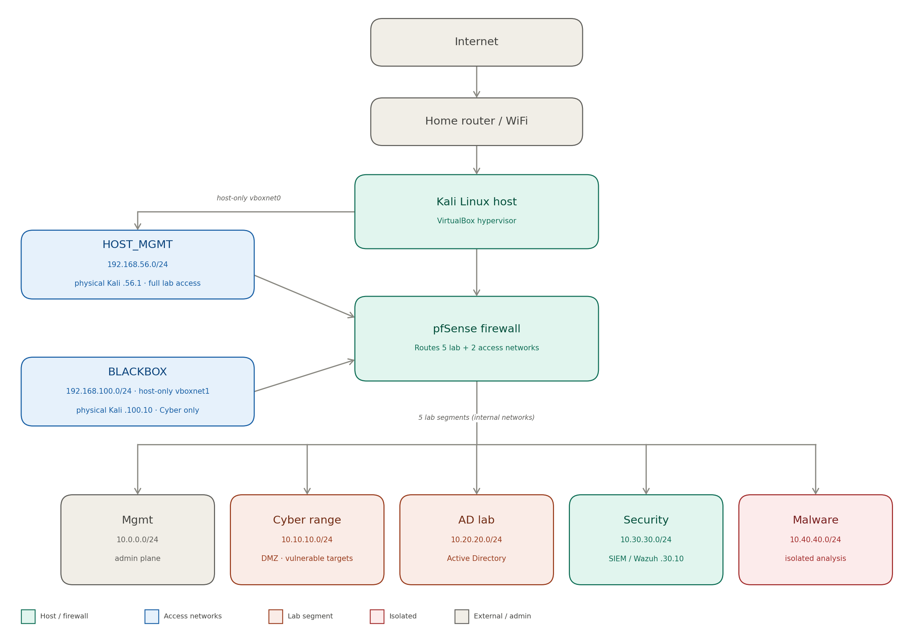
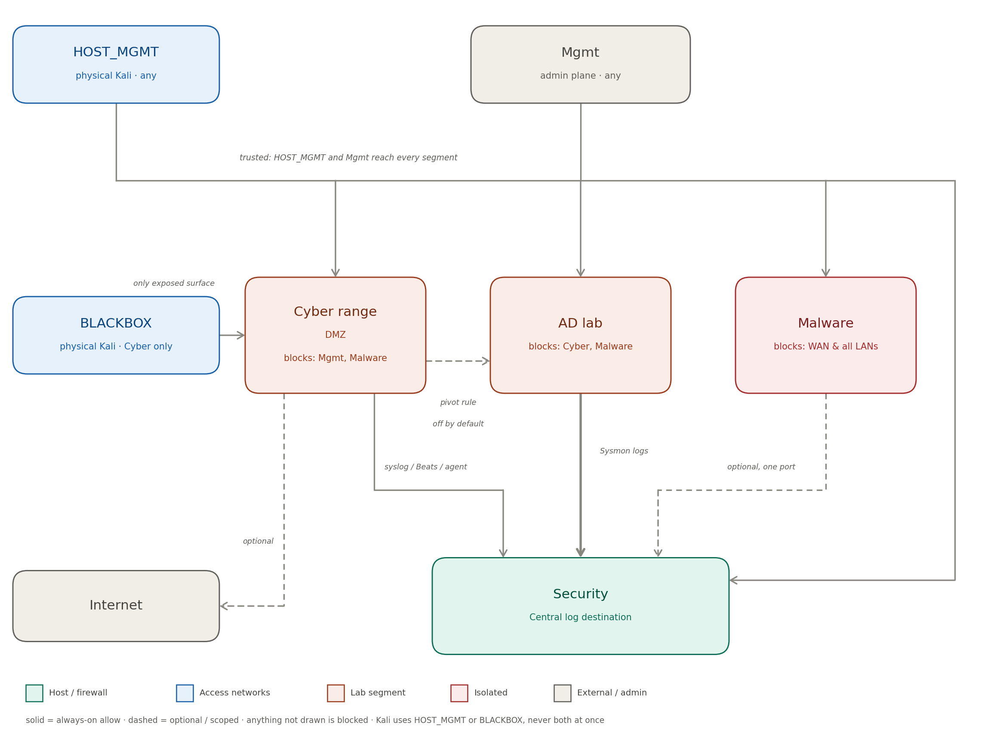

# Home Cybersecurity Lab — Enterprise Firewall & Network Segmentation Build Documentation

A production-grade, segmented VirtualBox-based home lab built on a physical Kali Linux host, providing a realistic environment for penetration testing, Active Directory security, SOC/detection engineering, and malware analysis — all strictly isolated behind a 7-interface pfSense enterprise firewall.

---

## Related Documentation by Section

- [Architecture & design rationale](architecture/design-rationale.md)
- [IP allocation plan](architecture/ip-plan.md)
- [VirtualBox host networking](installation/virtualbox.md)
- [pfSense installation](installation/pfsense-install.md)
- [Interface assignment & NIC mapping](installation/interface-assignment.md)
- [Kali host network setup](installation/kali-network-setup.md)
- [pfSense DHCP configuration](installation/dhcp.md)
- [Firewall rule matrix](configuration/firewall-rules.md)
- [Firewall aliases](configuration/aliases.md)
- [NAT & port forwarding](configuration/nat.md)
- [DNS resolver configuration](configuration/dns-resolver.md)
- [Connectivity validation tests](validation/connectivity.md)
- [Troubleshooting guide](validation/troubleshooting.md)

## Table of Contents

- [Home Cybersecurity Lab — Enterprise Firewall \& Network Segmentation Build Documentation](#home-cybersecurity-lab--enterprise-firewall--network-segmentation-build-documentation)
  - [Table of Contents](#table-of-contents)
  - [1. Architecture Overview](#1-architecture-overview)
    - [1.1 Lab Architecture Diagram](#11-lab-architecture-diagram)
    - [1.2 Network Subnet \& Interface Design](#12-network-subnet--interface-design)
    - [1.3 Core Hosts \& Addressing](#13-core-hosts--addressing)
  - [2. Recommended Build Order](#2-recommended-build-order)
  - [3. Physical Host Setup (Kali Linux)](#3-physical-host-setup-kali-linux)
    - [3.1 Hypervisor Installation](#31-hypervisor-installation)
    - [3.2 Host Security Recommendation](#32-host-security-recommendation)
  - [4. VirtualBox Virtual Networking](#4-virtualbox-virtual-networking)
    - [4.1 Internal Networks (Lab LAN Segments)](#41-internal-networks-lab-lan-segments)
    - [4.2 Host-Only Network (Kali Access Link)](#42-host-only-network-kali-access-link)
    - [4.3 Whitelisting Host-Only Subnet](#43-whitelisting-host-only-subnet)
  - [5. pfSense — Router \& Enterprise Firewall](#5-pfsense--router--enterprise-firewall)
    - [5.1 VM Sizing \& Provisioning](#51-vm-sizing--provisioning)
      - [Automated Provisioning via CLI](#automated-provisioning-via-cli)
      - [Adapter Limits \& Chipset Notes](#adapter-limits--chipset-notes)
    - [5.2 Interface Assignment \& Mapping Reference](#52-interface-assignment--mapping-reference)
    - [5.3 Stateful Filtering Principles \& Ingress Evaluation](#53-stateful-filtering-principles--ingress-evaluation)
    - [5.4 Firewall Rule Matrices Per Interface](#54-firewall-rule-matrices-per-interface)
      - [Prerequisite: `RFC1918_Networks` Alias \& "Internet" Destinations](#prerequisite-rfc1918_networks-alias--internet-destinations)
      - [1. Management Interface (`MGMT` / `em1`)](#1-management-interface-mgmt--em1)
      - [2. Cyber Range Interface (`CYBER` / `em2`)](#2-cyber-range-interface-cyber--em2)
      - [3. Active Directory Interface (`AD` / `em3`)](#3-active-directory-interface-ad--em3)
      - [4. Security Operations Interface (`SECURITY` / `em4`)](#4-security-operations-interface-security--em4)
      - [5. Malware Sandbox Interface (`MALWARE` / `em5`)](#5-malware-sandbox-interface-malware--em5)
      - [6. HOST\_MGMT Interface (`HOST_MGMT` / `em6`)](#6-host_mgmt-interface-host_mgmt--em6)
    - [5.5 Overall Firewall Traffic Flow Diagram](#55-overall-firewall-traffic-flow-diagram)
    - [5.6 Configuration Backup Protocol](#56-configuration-backup-protocol)
    - [5.7 HOST\_MGMT — Trusted Kali Administration Access](#57-host_mgmt--trusted-kali-administration-access)
    - [5.8 Kali Administration Access \& Routing Script (`lab-trusted.sh`)](#58-kali-administration-access--routing-script-lab-trustedsh)
    - [5.9 Console Walkthrough: Assigning `em6` as HOST\_MGMT](#59-console-walkthrough-assigning-em6-as-host_mgmt)
    - [5.10 Troubleshooting: HOST\_MGMT Adapter (`em6`) Not Showing in pfSense](#510-troubleshooting-host_mgmt-adapter-em6-not-showing-in-pfsense)
  - [6. Segment 1 — Management Enclave (`10.0.0.0/24`)](#6-segment-1--management-enclave-1000024)
  - [7. Segment 2 — Cyber Range \& DMZ (`10.10.10.0/24`)](#7-segment-2--cyber-range--dmz-101010024)
    - [7.1 Core \& Intermediate Target Workstations](#71-core--intermediate-target-workstations)
    - [7.2 Sysmon Monitoring on Metasploitable 3 (Server 2008 R2)](#72-sysmon-monitoring-on-metasploitable-3-server-2008-r2)
    - [7.3 Juice Shop \& DVWA Deployment](#73-juice-shop--dvwa-deployment)
    - [7.4 SafeLine WAF Reverse Proxy Deployment](#74-safeline-waf-reverse-proxy-deployment)
  - [8. Segment 3 — Active Directory Lab (`10.20.20.0/24`)](#8-segment-3--active-directory-lab-102020024)
    - [8.1 Domain Controller \& Forest Setup](#81-domain-controller--forest-setup)
    - [8.2 Client Workstation Join \& Auditing Configuration](#82-client-workstation-join--auditing-configuration)
    - [8.3 Attack Tooling \& Security Exercises](#83-attack-tooling--security-exercises)
  - [9. Segment 4 — Security Monitoring \& SIEM (`10.30.30.0/24`)](#9-segment-4--security-monitoring--siem-103030024)
    - [9.1 Detection Stack \& Architecture](#91-detection-stack--architecture)
    - [9.2 Log Collection \& Ingestion Channels](#92-log-collection--ingestion-channels)
    - [9.3 Hands-On Detection Engineering Scenarios](#93-hands-on-detection-engineering-scenarios)
  - [10. Segment 5 — Malware Analysis Sandbox (`10.40.40.0/24`)](#10-segment-5--malware-analysis-sandbox-104040024)
    - [10.1 Multi-Layered Sandbox Isolation](#101-multi-layered-sandbox-isolation)
    - [10.2 Fake Internet Simulation (INetSim / FakeNet-NG)](#102-fake-internet-simulation-inetsim--fakenet-ng)
    - [10.3 Analysis Tooling \& Golden Image Snapshots](#103-analysis-tooling--golden-image-snapshots)
  - [11. Comprehensive Component \& Download Reference](#11-comprehensive-component--download-reference)
  - [12. Testing \& Validation Procedures](#12-testing--validation-procedures)
    - [12.1 Inter-Segment Connectivity Matrix Validation](#121-inter-segment-connectivity-matrix-validation)
    - [12.2 Service Reachability Checks](#122-service-reachability-checks)
    - [12.3 End-to-End SOC Detection Proof](#123-end-to-end-soc-detection-proof)
    - [12.4 Malware Sandbox Isolation Verification](#124-malware-sandbox-isolation-verification)
    - [12.5 Access Mode Verification](#125-access-mode-verification)
      - [HOST\_MGMT Verification:](#host_mgmt-verification)
  - [13. Master Lab Build Checklist](#13-master-lab-build-checklist)
  - [14. Repository Structure \& Modular Sub-Guides](#14-repository-structure--modular-sub-guides)
  - [License \& Attribution](#license--attribution)

---

## 1. Architecture Overview

### 1.1 Lab Architecture Diagram




**Key Architectural Concept:**
- **Kali Linux is the physical host operating system**, not a virtual machine.
- Oracle VM VirtualBox runs directly on top of Kali and hosts all lab VMs, including pfSense Community Edition.
- pfSense serves as the virtual core router and policy enforcement firewall across **five internal isolated virtual networks** (`intnet-*`).
- The physical Kali host sits **strictly outside** the internal segments. It never attaches directly to any internal network.
- Administrative access is handled via a dedicated host-only adapter (`vboxnet0`), ensuring complete network containment without bridging the host into the internal broadcast domains.

---

### 1.2 Network Subnet & Interface Design

| Network Name    | Interface    | Subnet Range      | pfSense IP      | Attachment Type             | Purpose & Policy                                    |
| :-------------- | :----------- | :---------------- | :-------------- | :-------------------------- | :-------------------------------------------------- |
| **WAN**         | `em0`        | DHCP (NAT)        | Assigned by NAT | VirtualBox NAT              | Upstream Internet access via host Wi-Fi/Ethernet    |
| **Mgmt**        | `em1` (LAN)  | `10.0.0.0/24`     | `10.0.0.1`      | Internal (`intnet-mgmt`)    | Dedicated administrative enclave; pfSense WebGUI    |
| **Cyber Range** | `em2` (OPT1) | `10.10.10.0/24`   | `10.10.10.1`    | Internal (`intnet-cyber`)   | Deliberately vulnerable systems; doubles as lab DMZ |
| **AD Lab**      | `em3` (OPT2) | `10.20.20.0/24`   | `10.20.20.1`    | Internal (`intnet-ad`)      | Windows Domain Controller, forest members, Kerberos |
| **Security**    | `em4` (OPT3) | `10.30.30.0/24`   | `10.30.30.1`    | Internal (`intnet-sec`)     | Centralized monitoring, Wazuh SIEM, log collection  |
| **Malware**     | `em5` (OPT4) | `10.40.40.0/24`   | `10.40.40.1`    | Internal (`intnet-malware`) | Quarantined dynamic detonation; zero WAN egress     |
| **HOST_MGMT**   | `em6` (OPT5) | `192.168.56.0/24` | `192.168.56.2`  | Host-only (`vboxnet0`)      | Trusted physical Kali management path               |

> [!NOTE]
> Device identifiers (`em0`–`em6`) represent default FreeBSD mappings when using Intel PRO/1000 MT adapters (`82540EM` or `82545EM`). Always verify exact interface-to-adapter assignments by checking MAC addresses under pfSense **Interfaces → Assignments**.

---

### 1.3 Core Hosts & Addressing

| Host Name / Role        | Segment          | Assigned IP                  | Description                                                      |
| :---------------------- | :--------------- | :--------------------------- | :--------------------------------------------------------------- |
| **pfSense Firewall**    | Core Gateway     | `10.0.0.1`<br>`192.168.56.2` | Central router, Unbound DNS, stateful packet filter, DHCP server |
| **Management Ubuntu**   | Mgmt             | `10.0.0.10`                  | GUI management workstation for out-of-band administration        |
| **Metasploitable 2**    | Cyber Range      | `10.10.10.10`                | Legacy unpatched Linux target                                    |
| **Metasploitable 3**    | Cyber Range      | `10.10.10.20`                | Windows Server 2008 R2 target running Sysmon telemetry           |
| **SafeLine WAF**        | Cyber Range      | `10.10.10.50`                | Reverse proxy WAF protecting web applications                    |
| **Primary DC (`DC01`)** | Active Directory | `10.20.20.10`                | Windows Server 2022 Domain Controller (`lab.local`)              |
| **Windows Clients**     | Active Directory | `10.20.20.20`, `.30`         | Domain-joined client endpoints                                   |
| **Wazuh / SIEM Host**   | Security         | `10.30.30.10`                | Security Onion / Wazuh Manager, Indexer & Dashboard              |
| **FLARE VM / REMnux**   | Malware          | `10.40.40.10`                | Reverse engineering & behavioral analysis sandboxes              |
| **FakeNet / INetSim**   | Malware          | `10.40.40.20`                | Local simulated Internet service responder                       |
| **Physical Kali Host**  | HOST_MGMT        | `192.168.56.1`               | Trusted administrator on `vboxnet0`                              |

---

## 2. Recommended Build Order

To avoid circular dependencies and having to touch virtual machine network settings multiple times, follow this precise deployment sequence:

```text
┌────────────────────────────────────────────────────────────────────────┐
│                        SEQUENTIAL BUILD PIPELINE                       │
└────────────────────────────────────────────────────────────────────────┘
  1. HOST & NETWORKS  ──> 2. PFSENSE CORE  ──> 3. ACCESS LINKS
            │                     │                   │
            ▼                     ▼                   ▼
  4. MGMT WORKSTATION ──> 5. CYBER RANGE   ──> 6. AD LAB
            │                     │                   │
            ▼                     ▼                   ▼
  7. SECURITY SIEM    ──> 8. MALWARE LAB   ──> 9. VALIDATION
```

1. **Host Setup & Whitelisting**: Install VirtualBox + Extension Pack on Kali Linux and configure `/etc/vbox/networks.conf` (Section 3 & 4.3).
2. **VirtualBox Virtual Networks**: Create the 5 internal networks (`intnet-*`) and 1 host-only network (`vboxnet0`) (Section 4).
3. **pfSense Core Provisioning**: Deploy pfSense with 7 network adapters, install the OS, assign interfaces, set static gateway IPs, and enable DHCP (Section 5.1–5.2, 5.9).
4. **Access Network Activation**: Set up `HOST_MGMT` rules and verify routing from the physical Kali host (Section 5.7–5.8).
5. **Segment 1 — Management Deployment**: Deploy the Ubuntu Management VM (`10.0.0.10`) on `intnet-mgmt` to administer pfSense via WebGUI (`https://10.0.0.1`) (Section 6).
6. **Segment 2 — Cyber Range Targets**: Deploy Metasploitable 2/3, OWASP Juice Shop, DVWA, and SafeLine WAF on `intnet-cyber` (Section 7).
7. **Segment 3 — Active Directory Lab**: Deploy Windows Server 2022 (`DC01`), promote `lab.local`, join client endpoints, and deploy Sysmon (Section 8).
8. **Segment 4 — Security Monitoring**: Deploy Wazuh / Security Onion on `intnet-sec`, configure pfSense syslog forwarding, and ingest host telemetry (Section 9).
9. **Segment 5 — Malware Analysis**: Build FLARE VM / REMnux with temporary internet access, disconnect to `intnet-malware`, enforce default-deny, and snapshot clean baselines (Section 10).
10. **Testing & Validation**: Execute the full connectivity matrix and SOC alert verification tests (Section 12).

---

## 3. Physical Host Setup (Kali Linux)

The physical workstation runs bare-metal Kali Linux. Because Kali serves as the virtualization hypervisor and primary attack platform, system hygiene is paramount:

### 3.1 Hypervisor Installation

```bash
# Update local package indexes
sudo apt update && sudo apt full-upgrade -y

# Install VirtualBox and DKMS kernel module dependencies
sudo apt install -y virtualbox virtualbox-ext-pack dkms

# Add your current user to the vboxusers group
sudo usermod -aG vboxusers $USER
```

Reboot or log out and back in to ensure group memberships take effect:
```bash
newgrp vboxusers
```

### 3.2 Host Security Recommendation
Treat the physical Kali host as an attack workstation and hypervisor platform, **not as a personal daily-driver workstation**. Conduct web browsing and everyday tasks on a separate machine or isolated environment to prevent exposing host credentials while testing exploits or handling malware.

---

## 4. VirtualBox Virtual Networking

### 4.1 Internal Networks (Lab LAN Segments)

VirtualBox **Internal Networks** create isolated virtual switches that connect guest virtual machines to each other without exposing traffic to the host's physical network adapters.

In VirtualBox: **Tools → Network Manager → Internal Networks** (or dynamically created in VM settings):

| Internal Network Name | Logical Segment   | Subnet          | Gateway      |
| :-------------------- | :---------------- | :-------------- | :----------- |
| `intnet-mgmt`         | Management        | `10.0.0.0/24`   | `10.0.0.1`   |
| `intnet-cyber`        | Cyber Range / DMZ | `10.10.10.0/24` | `10.10.10.1` |
| `intnet-ad`           | Active Directory  | `10.20.20.0/24` | `10.20.20.1` |
| `intnet-sec`          | Security / SIEM   | `10.30.30.0/24` | `10.30.30.1` |
| `intnet-malware`      | Malware Sandbox   | `10.40.40.0/24` | `10.40.40.1` |

---

### 4.2 Host-Only Network (Kali Access Link)

Because a physical host cannot attach directly to a VirtualBox *internal* network, a **Host-Only Network** is created to bridge Kali to the firewall:

| Network Name | Interface | Kali Host IP      | pfSense IP        | Role                                       |
| :----------- | :-------- | :---------------- | :---------------- | :----------------------------------------- |
| `vboxnet0`   | Adapter 7 | `192.168.56.1/24` | `192.168.56.2/24` | **HOST_MGMT**: Trusted administration path |

> [!IMPORTANT]
> Disable the built-in VirtualBox DHCP server on `vboxnet0`. Both the physical host and pfSense use static IP configurations.

Confirm the host-only network exists and is configured correctly before attaching it to the VM:

```bash
VBoxManage list hostonlyifs
```

Expected output includes `Name: vboxnet0`, `DHCP: Disabled`, `IPAddress: 192.168.56.1`, `NetworkMask: 255.255.255.0` and `Status: Up`. If `vboxnet0` is missing, create it:

```bash
VBoxManage hostonlyif create
VBoxManage hostonlyif ipconfig vboxnet0 --ip 192.168.56.1 --netmask 255.255.255.0
```

> [!NOTE]
> On VirtualBox 7.x, host-only networks may also be managed as `hostonlynets`. If `list hostonlyifs` returns nothing, check `VBoxManage list hostonlynets` and use whichever shows your `192.168.56.x` network.

---

### 4.3 Whitelisting Host-Only Subnet

Modern VirtualBox releases on Linux restrict host-only subnets to `192.168.56.0/21` by default. If using custom host-only ranges, they must be explicitly whitelisted in VirtualBox system configuration:

```bash
# Whitelist host-only ranges in VirtualBox networks configuration
sudo mkdir -p /etc/vbox
printf '* 192.168.56.0/24\n' | sudo tee /etc/vbox/networks.conf
```

After updating the whitelist, create `vboxnet0` in the VirtualBox GUI (**Tools → Network → Host-only Networks**) or via CLI.

---

## 5. pfSense — Router & Enterprise Firewall

### 5.1 VM Sizing & Provisioning

| Hardware Parameter   | Specification       | Purpose / Rationale                                        |
| :------------------- | :------------------ | :--------------------------------------------------------- |
| **VM Name**          | `pfSense`  | Core virtual appliance                                     |
| **OS Type**          | FreeBSD (64-bit)    | Base operating system for pfSense CE                       |
| **Processors**       | `2 vCPU`            | Handles multi-queue packet inspection and routing          |
| **RAM**              | `1024 MB – 2048 MB` | 1GB is baseline; 2GB recommended if running Snort/Suricata |
| **Storage Disk**     | `20 GB VDI`         | Dynamically allocated storage for logs and states          |
| **Network Adapters** | **7 Adapters**      | 1 WAN + 5 Internal Segments + 1 Host-Only Access Link      |

#### Automated Provisioning via CLI

You can provision the VM and attach all 7 network adapters automatically using the repository script:

```bash
chmod +x installation/setup-vbox-vm.sh
./installation/setup-vbox-vm.sh "pfSense" "${HOME}/Downloads/pfSense-CE-2.7.2-RELEASE-amd64.iso"
```

Or configure manually using `VBoxManage`:

> [!IMPORTANT]
> `VBoxManage modifyvm` only works while the VM is **fully powered off**. If the VM is running, saved, or aborted, you will get `VBOX_E_INVALID_OBJECT_STATE (0x80bb0007)` / "The machine is already locked for a session". See [Section 5.10](#510-troubleshooting-host_mgmt-adapter-em6-not-showing-in-pfsense).

```bash
# NIC 1: WAN (VirtualBox NAT)
VBoxManage modifyvm "pfSense" --nic1 nat --nictype1 82545EM

# NIC 2: Management (intnet-mgmt)
VBoxManage modifyvm "pfSense" --nic2 intnet --intnet2 "intnet-mgmt" --nictype2 82545EM

# NIC 3: Cyber Range (intnet-cyber)
VBoxManage modifyvm "pfSense" --nic3 intnet --intnet3 "intnet-cyber" --nictype3 82545EM

# NIC 4: Active Directory (intnet-ad)
VBoxManage modifyvm "pfSense" --nic4 intnet --intnet4 "intnet-ad" --nictype4 82545EM

# NIC 5: Security Operations (intnet-sec)
VBoxManage modifyvm "pfSense" --nic5 intnet --intnet5 "intnet-sec" --nictype5 82545EM

# NIC 6: Malware Analysis (intnet-malware)
VBoxManage modifyvm "pfSense" --nic6 intnet --intnet6 "intnet-malware" --nictype6 82545EM

# NIC 7: HOST_MGMT (vboxnet0)
VBoxManage modifyvm "pfSense" --nic7 hostonly --hostonlyadapter7 "vboxnet0" --nictype7 82545EM
```

Verify the adapter configuration after provisioning:

```bash
VBoxManage showvminfo "pfSense" | grep -E "^NIC [0-9]"
```

NIC 7 should read `Attachment: Host-only Interface 'vboxnet0'`, `Cable connected: on`, and a Type of `82540EM` or `82545EM`. Note the NIC 7 MAC address, as you will use it to identify `em6` inside pfSense.

#### Adapter Limits & Chipset Notes

- The VirtualBox GUI exposes only **4 adapters** on the default PIIX3 chipset. Adapters 5–8 must be configured via `VBoxManage` (as above).
- The **ICH9 chipset** exposes up to 8 adapters in the GUI (and more via CLI). Switch with the VM powered off: `VBoxManage modifyvm "pfSense" --chipset ich9`.
- `82540EM` (Intel PRO/1000 MT Desktop) and `82545EM` (Intel PRO/1000 MT Server) both appear as `em` devices in pfSense. Mixing them is harmless; pfSense reports them as `em0`–`em6` either way.

---

### 5.2 Interface Assignment & Mapping Reference

During pfSense initial console setup or via **Interfaces → Assignments**:

| VirtualBox Adapter | Default Driver | Assigned Interface | Rename To   | Static Gateway IP | Role                       |
| :----------------- | :------------- | :----------------- | :---------- | :---------------- | :------------------------- |
| **Adapter 1**      | `em0`          | **WAN**            | `WAN`       | DHCP from NAT     | Internet Access            |
| **Adapter 2**      | `em1`          | **LAN**            | `MGMT`      | `10.0.0.1/24`     | Management plane & WebGUI  |
| **Adapter 3**      | `em2`          | **OPT1**           | `CYBER`     | `10.10.10.1/24`   | Cyber range targets / DMZ  |
| **Adapter 4**      | `em3`          | **OPT2**           | `AD`        | `10.20.20.1/24`   | Active Directory domain    |
| **Adapter 5**      | `em4`          | **OPT3**           | `SECURITY`  | `10.30.30.1/24`   | SIEM & centralized logs    |
| **Adapter 6**      | `em5`          | **OPT4**           | `MALWARE`   | `10.40.40.1/24`   | Quarantined sandbox        |
| **Adapter 7**      | `em6`          | **OPT5**           | `HOST_MGMT` | `192.168.56.2/24` | Trusted physical Kali link |

> [!CAUTION]
> On `HOST_MGMT`, **do NOT specify an IPv4 Upstream Gateway**. Leaving the gateway unset marks it as a local broadcast link and prevents routing conflicts with the WAN default gateway.

> [!NOTE]
> The pfSense console main menu only lists interfaces that are **already assigned**. An unassigned NIC such as `em6` will not appear there. To confirm pfSense detects it, choose **1) Assign Interfaces** and check the "Valid interfaces are" list (Section 5.9).

---

### 5.3 Stateful Filtering Principles & Ingress Evaluation

1. **Ingress Filtering**: pfSense inspects and enforces firewall rules on the interface where packets **enter** the firewall. To regulate traffic originating from the Cyber Range targeting Active Directory, the rule must be configured on the **CYBER** tab, not the AD tab.
2. **Stateful Inspection**: When an outbound connection is permitted, return reply packets are automatically permitted by the state engine.
3. **Top-to-Bottom, First-Match-Wins**: Rules are evaluated strictly in order. Specific block or pass rules must always precede broader catch-all rules.
4. **Implicit Default-Deny**: Traffic not matching an explicit pass rule is automatically dropped by the implicit deny rule at the bottom of every interface.

---

### 5.4 Firewall Rule Matrices Per Interface

#### Prerequisite: `RFC1918_Networks` Alias & "Internet" Destinations

> [!WARNING]
> In pfSense, the destination **`WAN address`** matches only the firewall's own WAN IP (e.g. `10.0.2.15`), and **`WAN subnets`** matches only the WAN's own network (e.g. `10.0.2.0/24`). Neither means "the internet". A rule using either will not allow updates or any other internet traffic.
>
> Where the matrices below say **Internet**, use **Invert match** with the alias `RFC1918_Networks`. This reads as "anything that is not a private address". Do **not** use destination `any` for these rules: `any` would also match other lab segments and, being first-match-wins, would bypass the block rules lower down.

Create the alias before building any rule that references it (**Firewall → Aliases → IP → Add**, then **Apply Changes**):

| Field   | Value                                          |
| :------ | :--------------------------------------------- |
| Name    | `RFC1918_Networks`                             |
| Type    | Network(s)                                     |
| Entries | `10.0.0.0/8`, `172.16.0.0/12`, `192.168.0.0/16` |

The SECURITY rules also use the following aliases (**Firewall → Aliases**, then **Apply Changes**):

| Alias                  | Menu tab | Type       | Entries                                          | Used by                          |
| :--------------------- | :------- | :--------- | :----------------------------------------------- | :------------------------------- |
| `Internal_Lab_Subnets` | IP       | Network(s) | `10.10.10.0/24` (CYBER), `10.20.20.0/24` (AD)    | SECURITY rule 2                  |
| `SIEM_Scoped_Ports`    | Ports    | Port(s)    | `22`, `80`, `443`, `445`, `3389`, `5985`         | SECURITY rule 2                  |
| `Web_Ports`            | Ports    | Port(s)    | `80`, `443`                                      | SECURITY rule 3                  |

Adjust `SIEM_Scoped_Ports` to the services you actually scan or poll.

To build an **Internet** rule in the rule editor: tick **Invert match** next to Destination, choose **Address or Alias**, and enter `RFC1918_Networks`.

Outbound NAT for the OPT interfaces is automatic by default, so no NAT changes are needed for internet access. Rules marked *Optional* or *Disabled* can be saved with **Disable this rule** ticked and enabled only when needed.

#### 1. Management Interface (`MGMT` / `em1`)
*Trusted administrative zone with full reach across all lab segments.*

| Rule Order |  Action  | Protocol |   Source   | Destination | Port  | Purpose                                              |
| :--------: | :------: | :------: | :--------: | :---------: | :---: | :--------------------------------------------------- |
|     1      | **Pass** | IPv4 Any | `MGMT net` |    `any`    |  Any  | Full reach needed to administer all virtual machines |

#### 2. Cyber Range Interface (`CYBER` / `em2`)
*Vulnerable targets and DMZ. Outbound lateral movement is blocked.*

| Rule Order |       Action        | Protocol |   Source    |      Destination      |    Port    | Purpose                                                          |
| :--------: | :-----------------: | :------: | :---------: | :-------------------: | :--------: | :--------------------------------------------------------------- |
|     1      |      **Pass**       | TCP/UDP  | `CYBER net` |    `CYBER address`   |     53     | DNS queries to the pfSense resolver (needed once rule 2 is on)   |
|     2      | **Pass** (Optional) | IPv4 Any | `CYBER net` | **Internet** (`!RFC1918_Networks`) | Any | Target software updates/patching (enable when needed)          |
|     3      |      **Pass**       |   UDP    | `CYBER net` |    `10.30.30.10`     |    514     | Syslog forwarding to Wazuh / SIEM                                |
|     4      |      **Pass**       |   TCP    | `CYBER net` |    `10.30.30.10`     | 1514, 1515 | Wazuh agent registration & events                                |
|     5      |      **Pass**       |   TCP    | `CYBER net` |    `10.30.30.10`     |    5044    | Beats log shipping (Winlogbeat / Filebeat)                       |
|     6      | **Pass** (Disabled) | IPv4 Any | `CYBER net` |       `AD net`       |    Any     | **Lateral pivot rule** — enable only during pivoting drills      |
|     7      |      **Block**      | IPv4 Any | `CYBER net` |      `MGMT net`      |    Any     | Isolate management plane from compromised targets                |
|     8      |      **Block**      | IPv4 Any | `CYBER net` |    `MALWARE net`     |    Any     | Prevent targets from interacting with detonating malware         |
|     9      |      **Block**      | IPv4 Any | `CYBER net` |    `SECURITY net`    |    Any     | Catch-all block for remaining SIEM ports                         |

> [!NOTE]
> Rule 2 excludes all private addresses, so CYBER hosts cannot reach the pfSense resolver at `10.10.10.1` through it. Rule 1 provides DNS; without it, name resolution fails even when rule 2 is enabled. When creating rule 2, set Source to `CYBER subnets`, Protocol to Any, and give it a description such as `Optional: CYBER internet for updates`.

#### 3. Active Directory Interface (`AD` / `em3`)
*Corporate enterprise network. Lateral egress to Cyber Range and Malware is prohibited.*

| Rule Order |       Action        | Protocol |     Source     |  Destination  |      Port       | Purpose                                                   |
| :--------: | :-----------------: | :------: | :------------: | :-----------: | :-------------: | :-------------------------------------------------------- |
|     1      |      **Pass**       | TCP/UDP  |    `AD net`    | `10.30.30.10` | 514, 1514, 5044 | Forward Windows Event Logs & Sysmon to SIEM               |
|     2      | **Pass** (Optional) | IPv4 Any | Approved Hosts | **Internet** (`!RFC1918_Networks`) |     80, 443     | Microsoft updates / time synchronization                  |
|     3      |      **Block**      | IPv4 Any |    `AD net`    |  `CYBER net`  |       Any       | AD cannot initiate unprompted scans into the attack range |
|     4      |      **Block**      | IPv4 Any |    `AD net`    | `MALWARE net` |       Any       | Absolute isolation from malware detonation zone           |

#### 4. Security Operations Interface (`SECURITY` / `em4`)
*Defensive monitoring and detection platform. Initiates scoped connections into the Cyber Range and AD segments only; it has no path into MGMT or MALWARE.*

| Rule Order |  Action  | Protocol |      Source      |            Destination             |        Port         | Purpose                                                   |
| :--------: | :------: | :------: | :--------------: | :--------------------------------: | :-----------------: | :-------------------------------------------------------- |
|     1      | **Pass** | TCP/UDP  | `SECURITY net`   |         `SECURITY address`         |         53          | DNS queries to the pfSense resolver                       |
|     2      | **Pass** |   TCP    | `SECURITY net`   |       `Internal_Lab_Subnets`       | `SIEM_Scoped_Ports` | Active polling, vulnerability scanning, and agent queries |
|     3      | **Pass** | TCP/UDP  | `SECURITY net`   | **Internet** (`!RFC1918_Networks`) |    `Web_Ports`      | Threat intelligence feed updates and SIEM rulesets        |

> [!NOTE]
> Rule 3 excludes all private addresses, so the SIEM host cannot reach the pfSense resolver through it. Rule 1 provides DNS; without it, name resolution for feed updates fails.
>
> Rule 2 uses TCP because pfSense port aliases only apply to TCP, UDP, or TCP/UDP rules (with Protocol set to Any, no port fields appear). Add a separate ICMP rule to `Internal_Lab_Subnets` if the SIEM needs ping-based host checks.
>
> `Internal_Lab_Subnets` deliberately omits MGMT and MALWARE. Add them only if a specific use case requires it.

#### 5. Malware Sandbox Interface (`MALWARE` / `em5`)
*Default-deny quarantine zone. Zero WAN egress, zero lateral movement.*

| Rule Order |      Action       | Protocol |    Source     |    Destination     |    Port     | Purpose                                             |
| :--------: | :---------------: | :------: | :-----------: | :----------------: | :---------: | :-------------------------------------------------- |
|     1      |     **Block**     | IPv4 Any | `MALWARE net` | **Internet** (`!RFC1918_Networks`) |     Any     | **Critical: Zero Internet egress**                  |
|     2      |     **Block**     | IPv4 Any | `MALWARE net` | `RFC1918_Networks` |     Any     | Prevent lateral spread into any internal lab subnet |
|     3      | **Pass** (Narrow) | TCP/UDP  | `MALWARE net` |   `10.30.30.10`    | Scoped Port | Optional detonation telemetry pipe to SIEM          |

#### 6. HOST_MGMT Interface (`HOST_MGMT` / `em6`)
*Dedicated administrative channel for physical Kali.*

| Rule Order |  Action  | Protocol |     Source     | Destination | Port  | Purpose                                        |
| :--------: | :------: | :------: | :------------: | :---------: | :---: | :--------------------------------------------- |
|     1      | **Pass** | IPv4 Any | `192.168.56.1` |    `any`    |  Any  | Full laboratory administrative reach from Kali |

> [!NOTE]
> Newly created OPT interfaces have **no firewall rules**, so all traffic is dropped by the implicit default-deny until a pass rule is added. If `ping 192.168.56.2` fails after assignment, the missing HOST_MGMT pass rule is the first thing to check.

---

### 5.5 Overall Firewall Traffic Flow Diagram



---

### 5.6 Configuration Backup Protocol

Always create a full XML backup before making topology or firewall rule changes:
1. Navigate to **Diagnostics → Backup & Restore**.
2. Select **Backup Area: All** and click **Download configuration as XML**.
3. Store configuration archives securely on the physical host (e.g. `pfsense-backup-baseline.xml`).

---

### 5.7 HOST_MGMT — Trusted Kali Administration Access

HOST_MGMT provides the physical Kali workstation with an authorized administrative pipe into all five lab segments:

1. **VirtualBox Configuration**: Tools → Network → Host-only Networks → Create `vboxnet0` with IPv4 `192.168.56.1`, mask `255.255.255.0`. Disable DHCP.
2. **pfSense NIC**: Attach Adapter 7 to `vboxnet0` (VM powered off).
3. **pfSense Interface**: Assign `em6` as OPT5, rename to `HOST_MGMT`, IPv4 `192.168.56.2/24`, gateway **None** (Section 5.9).
4. **Firewall Rule**: Under **Firewall → Rules → HOST_MGMT**, create a pass rule with source `192.168.56.1` to destination `any`.

---

### 5.8 Kali Administration Access & Routing Script (`lab-trusted.sh`)

Use this bash script on Kali to cleanly activate routing into the lab segments via the host-only interface:

```bash
#!/usr/bin/env bash
# lab-trusted.sh — Laboratory administration via HOST_MGMT
set -euo pipefail

echo "[*] Activating Trusted Laboratory Administration..."
sudo ip link set vboxnet0 up
sudo ip addr replace 192.168.56.1/24 dev vboxnet0

for subnet in 10.0.0.0/24 10.10.10.0/24 10.20.20.0/24 10.30.30.0/24 10.40.40.0/24; do
  sudo ip route replace "${subnet}" via 192.168.56.2 dev vboxnet0
done

echo "[+] Trusted administration routing active via 192.168.56.2:"
ip route | grep -E "10\.|192\.168\."
```

Make the script executable:
```bash
chmod +x lab-trusted.sh
```

---

### 5.9 Console Walkthrough: Assigning `em6` as HOST_MGMT

Use this procedure after Adapter 7 has been attached to `vboxnet0` and the VM has been started.

**Step 1 — Confirm pfSense detects the NIC**

At the console menu choose **1) Assign Interfaces**. pfSense prints the detected NICs before asking any questions. You should see **seven** entries, and `em6` should show the same MAC address VirtualBox reported for NIC 7 (for example `08:00:27:32:12:90`). It will be marked `(down)` until it is configured, which is expected.

```text
Valid interfaces are:

em0     08:00:27:9f:9c:ab   (up)   Intel(R) Legacy PRO/1000 MT 82540EM
em1     08:00:27:15:aa:74   (up)   Intel(R) Legacy PRO/1000 MT 82545EM (Copper)
...
em6     08:00:27:32:12:90   (down) Intel(R) Legacy PRO/1000 MT 82540EM
```

**Step 2 — Answer the assignment prompts**

Re-enter the existing mappings exactly so nothing is remapped:

| Prompt                          | Answer                          |
| :------------------------------ | :------------------------------ |
| Should VLANs be set up now?     | `n`                             |
| WAN interface                   | `em0`                           |
| LAN interface                   | `em1`                           |
| Optional 1                      | `em2`                           |
| Optional 2                      | `em3`                           |
| Optional 3                      | `em4`                           |
| Optional 4                      | `em5`                           |
| Optional 5                      | `em6`                           |
| Optional 6                      | *(press Enter on a blank line)* |
| Proceed?                        | `y`                             |

After the reload, the main menu should list a new line such as `OPT5 (opt5) -> em6 -> (no IP)`. Existing interface names (MGMT, CYBER, AD, SECURITY, MALWARE) are preserved because they are stored per interface.

**Step 3 — Set the static IP**

Choose **2) Set interface(s) IP address**, select the new OPT5 interface, then:

| Prompt                                  | Answer                               |
| :-------------------------------------- | :----------------------------------- |
| Configure IPv4 address via DHCP?        | `n`                                  |
| IPv4 address                            | `192.168.56.2`                       |
| Subnet bit count                        | `24`                                 |
| IPv4 upstream gateway                   | *(press Enter for none)*             |
| Configure IPv6 via DHCP6?               | `n`                                  |
| IPv6 address                            | *(press Enter for none)*             |
| Enable DHCP server?                     | `n`                                  |
| Revert to HTTP as the webConfigurator?  | `n`                                  |

**Step 4 — Rename and enable in the WebGUI**

In **Interfaces → OPT5**: enable the interface, set the description to `HOST_MGMT`, confirm IPv4 Configuration Type is **Static IPv4**, address `192.168.56.2/24`, and Upstream Gateway **None**.

**Step 5 — Add the firewall rule and test**

Add the HOST_MGMT pass rule (Section 5.4, table 6), then from Kali:

```bash
./lab-trusted.sh
ping -c 3 192.168.56.2
```

---

### 5.10 Troubleshooting: HOST_MGMT Adapter (`em6`) Not Showing in pfSense

| Symptom | Likely Cause | Fix |
| :------ | :----------- | :-- |
| Console menu shows only `em0`–`em5` | The main menu only lists **assigned** interfaces; `em6` is not assigned yet | Run **1) Assign Interfaces** and check the "Valid interfaces are" list; assign `em6` as OPT5 (Section 5.9) |
| `em6` missing even in the "Valid interfaces" list | Adapter 7 not enabled in VirtualBox, or VM was not fully restarted after the change | Power off, verify with `VBoxManage showvminfo`, then start the VM again |
| `VBOX_E_INVALID_OBJECT_STATE (0x80bb0007)` / "machine is already locked for a session" | `modifyvm` run while the VM is running, saved, or being unlocked | Power off the VM completely (see below), then rerun the command |
| `modifyvm` rejects `--nic7` or `--hostonlyadapter7` | Chipset/adapter limit, or `vboxnet0` does not exist | Check `VBoxManage list hostonlyifs`; optionally switch to `--chipset ich9`; on VirtualBox 7.x also check `list hostonlynets` |
| `em6` appears but is `(down)` | Normal before configuration | Assign the interface and set the IP (Section 5.9) |
| CYBER hosts cannot reach the internet although the "WAN" pass rule exists | Destination set to `WAN address` or `WAN subnets`, which match only the firewall's own WAN IP/network | Use Invert match with `RFC1918_Networks` (Section 5.4), and add the CYBER DNS rule |
| `ping 192.168.56.2` fails after assignment | No pass rule on HOST_MGMT, or Kali not configured on `vboxnet0` | Add the HOST_MGMT pass rule; run `./lab-trusted.sh`; confirm Kali has `192.168.56.1/24` on `vboxnet0` |

**Resolving the session lock**

```bash
# Graceful shutdown (or use pfSense console option 6, Halt system)
VBoxManage controlvm "pfSense" acpipoweroff

# If it does not stop, force it
VBoxManage controlvm "pfSense" poweroff

# Confirm pfSense is no longer running
VBoxManage list runningvms

# If the VM is in a Saved state, discard it (a saved state also locks the config)
VBoxManage discardstate "pfSense"
```

**Verify the NIC is configured, then start the VM**

```bash
VBoxManage modifyvm "pfSense" --nic7 hostonly --hostonlyadapter7 vboxnet0 --nictype7 82540EM
VBoxManage showvminfo "pfSense" | grep -A3 "NIC 7"
VBoxManage startvm "pfSense"
```

A successful `modifyvm` prints nothing. The `showvminfo` line should show `Attachment: Host-only Interface 'vboxnet0'` and `Cable connected: on`.

**Last resort: check from the pfSense shell**

Choose **8) Shell** and run:

```bash
ifconfig -a | grep -E "^em|ether"
```

If `em6` is absent here, the guest cannot see the NIC at all, so recheck the VirtualBox adapter settings. If it is present, the problem is purely pfSense assignment, which Section 5.9 covers. Match MAC addresses against `VBoxManage showvminfo "pfSense" | grep "NIC "` to confirm which `emX` is which.

---

## 6. Segment 1 — Management Enclave (`10.0.0.0/24`)

The Management segment is an out-of-band administrative control plane. It contains no vulnerable workloads and maintains a minimal attack surface.

**Hosts in this Segment:**
- **pfSense Gateway / WebGUI**: `10.0.0.1` (`https://10.0.0.1`)
- **Ubuntu Management Workstation**: `10.0.0.10` (Static IP, attached to `intnet-mgmt`)

**Deployment Instructions:**
1. Create a minimal Ubuntu Desktop VM: 2 vCPU, 2GB RAM, 25GB disk.
2. Attach NIC 1 to `Internal Network` → `intnet-mgmt`.
3. Set static IPv4: `10.0.0.10`, Netmask: `255.255.255.0`, Gateway: `10.0.0.1`, DNS: `10.0.0.1`.
4. Open Firefox and access `https://10.0.0.1` to complete initial pfSense setup and add the HOST_MGMT pass rule.

---

## 7. Segment 2 — Cyber Range & DMZ (`10.10.10.0/24`)

The Cyber Range is an intentional offensive playground and isolated security testing DMZ.

### 7.1 Core & Intermediate Target Workstations

| Virtual Machine      | Category / Vulnerabilities                      | IP Allocation | Source Repository                    |
| :------------------- | :---------------------------------------------- | :------------ | :----------------------------------- |
| **Metasploitable 2** | Classic Linux services (VSFTPD, Samba, NFS)     | `10.10.10.10` | SourceForge                          |
| **Metasploitable 3** | Windows Server 2008 R2 (SMB, IIS, ManageEngine) | `10.10.10.20` | Rapid7 GitHub (Vagrant/Packer)       |
| **OWASP Juice Shop** | Modern Node.js web application (OWASP Top 10)   | `10.10.10.30` | Docker Hub (`bkimminich/juice-shop`) |
| **DVWA**             | Damn Vulnerable Web App (PHP / MySQL)           | `10.10.10.31` | GitHub (`digininja/DVWA`)            |
| **SafeLine WAF**     | Reverse proxy web application firewall          | `10.10.10.50` | Chaitin SafeLine                     |

---

### 7.2 Sysmon Monitoring on Metasploitable 3 (Server 2008 R2)

To enable end-to-end detection engineering during exploitation exercises against Metasploitable 3 Windows:

1. **Enable TLS 1.2 in Registry**: Because Windows Server 2008 R2 lacks TLS 1.2 by default, download will fail unless enabled:
   ```cmd
   reg add "HKLM\SYSTEM\CurrentControlSet\Control\SecurityProviders\SCHANNEL\Protocols\TLS 1.2\Client" /v DisabledByDefault /t REG_DWORD /d 0 /f
   reg add "HKLM\SYSTEM\CurrentControlSet\Control\SecurityProviders\SCHANNEL\Protocols\TLS 1.2\Client" /v Enabled /t REG_DWORD /d 1 /f
   ```
2. **Download Compatible Sysmon**: Use Sysmon v13.x or earlier (newer builds deprecate Server 2008 R2).
3. **Install with SwiftOnSecurity Baseline**:
   ```cmd
   sysmon64.exe -accepteula -i sysmonconfig-export.xml
   ```
4. **Log Shipping**: Install Winlogbeat or Wazuh Agent to ship Sysmon logs across the firewall to SIEM (`10.30.30.10`) via TCP port `5044` / `1514`.

---

### 7.3 Juice Shop & DVWA Deployment

Both web targets run in Docker on a single Ubuntu Server VM (`cyber-targets`: 1 vCPU, 2 GB RAM, 15 GB disk) attached to `intnet-cyber`. The VM carries two IP addresses so each app keeps its own address from the IP plan.

| App              | IP            | Port | Image                       |
| :--------------- | :------------ | :--: | :-------------------------- |
| **OWASP Juice Shop** | `10.10.10.30` | 3000 | `bkimminich/juice-shop`     |
| **DVWA**         | `10.10.10.31` | 80   | `vulnerables/web-dvwa`      |

> [!NOTE]
> The CYBER segment is offline by default. Before pulling images, temporarily enable the optional **Internet** rule on **Firewall → Rules → CYBER** (rule 2, Section 5.4) and click **Apply Changes**. Disable it again when deployment is finished. The CYBER DNS rule (rule 1) must be present for name resolution to work.

**1. Configure static addressing** in `/etc/netplan/50-cloud-init.yaml` (check the interface name with `ip a`; `enp0s3` is a common default):

```yaml
network:
  version: 2
  ethernets:
    enp0s3:
      addresses: [10.10.10.30/24, 10.10.10.31/24]
      routes:
        - to: default
          via: 10.10.10.1
      nameservers:
        addresses: [10.10.10.1]
```

```bash
sudo netplan apply
ping -c 2 8.8.8.8 && nslookup docker.com
```

**2. Install Docker:**

```bash
sudo apt update && sudo apt install -y docker.io
sudo systemctl enable --now docker
```

**3. Run the applications, each bound to its own IP:**

```bash
sudo docker run -d --name juice-shop --restart unless-stopped \
  -p 10.10.10.30:3000:3000 bkimminich/juice-shop

sudo docker run -d --name dvwa --restart unless-stopped \
  -p 10.10.10.31:80:80 vulnerables/web-dvwa
```

**4. Verify from Kali** (after running `./lab-trusted.sh`):
- Juice Shop: `http://10.10.10.30:3000`
- DVWA: `http://10.10.10.31/setup.php`. Click **Create / Reset Database**, then log in with `admin` / `password`. Under **DVWA Security**, set the level to Low to start.

---

### 7.4 SafeLine WAF Reverse Proxy Deployment

Deploying SafeLine WAF in front of web targets allows practicing web application firewall bypass techniques (parameter pollution, encoding tricks, request smuggling).

```text
Attacker (Kali) ──> SafeLine WAF (10.10.10.50) ──> Backend Target (DVWA / Juice Shop)
```

**Requirements** (SafeLine minimums): 1 CPU, 1 GB RAM, 5 GB disk, SSSE3 CPU support, Docker 20.10.14+ and Docker Compose 2.0.0+. This lab uses 2 vCPU, 2 GB RAM, 20 GB disk.

**Step-by-Step Installation:**
1. Deploy an Ubuntu Server VM attached to `intnet-cyber` at static IP `10.10.10.50/24`, gateway `10.10.10.1`, DNS `10.10.10.1` (same netplan layout as Section 7.3 with a single address). Temporarily enable the CYBER internet rule (Section 5.4).
2. Install Docker:
   ```bash
   sudo apt update && sudo apt install -y docker.io
   sudo systemctl enable --now docker
   ```
3. Run the official installer script:
   ```bash
   sudo bash -c "$(curl -fsSLk https://waf.chaitin.com/release/latest/manager.sh)" -- --en
   ```
4. Retrieve the generated administrator credentials:
   ```bash
   sudo docker exec safeline-mgt resetadmin
   ```
5. Access the console at `https://10.10.10.50:9443` from Kali (via HOST_MGMT) or the Management VM (`10.0.0.10`) and accept the self-signed certificate warning.

> [!NOTE]
> A manual Docker Compose install (`compose.yaml` plus a `.env` file) also works, but newer compose files read additional variables such as `RELEASE` and `REGION=-g`. A `.env` that sets only `SAFELINE_DIR`, `IMAGE_TAG`, `MGT_PORT`, `POSTGRES_PASSWORD`, `SUBNET_PREFIX`, `IMAGE_PREFIX` and `ARCH_SUFFIX` may fail to pull images. The installer script avoids this. Also, `docker-compose-plugin` is not in Ubuntu's default repositories, so use `docker.io` as above, or Docker's official repository.

**Publish the web targets behind the WAF** (**Applications → Add Application**). Each application needs its own WAF listening port:

| App            | Domain | WAF Port | Upstream                  |
| :------------- | :----- | :------: | :------------------------ |
| **DVWA**       | `*`    | `8081`   | `http://10.10.10.31:80`   |
| **Juice Shop** | `*`    | `8082`   | `http://10.10.10.30:3000` |

Browse to `http://10.10.10.50:8081` (DVWA) and `http://10.10.10.50:8082` (Juice Shop).

**Test the WAF** from Kali:

```bash
curl -i "http://10.10.10.50:8081/?id=1' OR '1'='1"
```

SafeLine should block the request (typically HTTP 403) and record it under the attack logs. The same request sent directly to `10.10.10.31` is not blocked, which gives a useful with-WAF vs without-WAF comparison.

**Optional: make the WAF the only way in.** Docker-published ports bypass `ufw`, so restrict the backends with the `DOCKER-USER` chain on the targets VM:

```bash
sudo iptables -I DOCKER-USER -p tcp -d 10.10.10.31 --dport 80 ! -s 10.10.10.50 -j DROP
sudo iptables -I DOCKER-USER -p tcp -d 10.10.10.30 --dport 3000 ! -s 10.10.10.50 -j DROP
```

> [!WARNING]
> `ufw` does **not** filter ports published by Docker. To isolate SafeLine's management port (`9443`) from the general Cyber Range, use a `DOCKER-USER` rule on the SafeLine VM, for example:
> ```bash
> sudo iptables -I DOCKER-USER -p tcp --dport 9443 ! -s 10.0.0.10 -j DROP
> ```
> Add a matching accept for `192.168.56.1` if you want Kali access, placed above the drop. Note that rules in `DOCKER-USER` are not persistent across reboots unless saved (for example with `iptables-persistent`).

**Finish up:** disable the CYBER internet rule again, apply changes, and take a clean snapshot of each VM.

---

## 8. Segment 3 — Active Directory Lab (`10.20.20.0/24`)

### 8.1 Domain Controller & Forest Setup

1. **Deploy VM**: Windows Server 2022 Evaluation (2 vCPU, 4GB RAM, 60GB disk), NIC attached to `intnet-ad`.
2. **Assign Static IP**: `10.20.20.10/24`, Gateway: `10.20.20.1`, DNS: `127.0.0.1`.
3. **Rename Server**: Rename machine to `DC01` and reboot.
4. **Promote Domain Controller**:
   - Install **Active Directory Domain Services (AD DS)** and DNS.
   - Promote server to Domain Controller in a new forest named `lab.local`.
   - Set Directory Services Restore Mode (DSRM) password and reboot.
5. **Populate Active Directory**:
   - Create Organizational Units: `IT`, `Finance`, `Operations`.
   - Add service accounts with Service Principal Names (SPNs) for Kerberoasting practice:
     ```powershell
     New-ADUser -Name "sqlservice" -SamAccountName "sqlservice" -PasswordNeverExpires $true
     Set-ADUser -Identity "sqlservice" -ServicePrincipalNames @{Add='MSSQLSvc/dc01.lab.local:1433'}
     ```

---

### 8.2 Client Workstation Join & Auditing Configuration

1. **Deploy Windows 10/11 Enterprise Evaluation**: Attach NIC to `intnet-ad`.
2. **Configure DNS**: Point client primary DNS to `10.20.20.10` (DC01).
3. **Join Domain**: Join machine to `lab.local` using Domain Admin credentials.
4. **Deploy Sysmon**: Install Sysmon on DC01 and all member endpoints using the SwiftOnSecurity configuration.
5. **Forward Telemetry**: Install Winlogbeat pointing to Wazuh / SIEM (`10.30.30.10:5044`).

---

### 8.3 Attack Tooling & Security Exercises

- **BloodHound & SharpHound**: Run SharpHound to map Active Directory ACL relationships and privilege escalation paths.
- **Kerberoasting**: Request TGS tickets for SPNs using Impacket's `GetUserSPNs.py` from Kali.
- **AS-REP Roasting**: Identify accounts with `Do not require Kerberos preauthentication`.
- **Pass-the-Hash / Credential Dumping**: Extract credentials via Mimikatz / `secretsdump.py`.

---

## 9. Segment 4 — Security Monitoring & SIEM (`10.30.30.0/24`)

### 9.1 Detection Stack & Architecture

- **Primary SIEM Host**: Wazuh Indexer, Server, and Dashboard all-in-one appliance (or Security Onion) deployed at `10.30.30.10/24`.
- **Ingestion Interfaces**:
  - `UDP 514`: Syslog from pfSense firewall filter logs
  - `TCP 1514 / 1515`: Wazuh agent events and enrollment
  - `TCP 5044`: Logstash / Beats ingest for Sysmon and Windows security event logs

---

### 9.2 Log Collection & Ingestion Channels

1. **pfSense Syslog Forwarding**:
   - In pfSense WebGUI: **Status → System Logs → Settings**.
   - Enable **Send log messages to remote syslog server**.
   - Specify Remote Syslog Server: `10.30.30.10:514`.
   - Select **Firewall Events** to capture state table and rule evaluations.
2. **Endpoint Agent Deployment**:
   - Deploy Wazuh Agent or Winlogbeat across Cyber Range and Active Directory endpoints.

---

### 9.3 Hands-On Detection Engineering Scenarios

- **Sigma Rule Creation**: Author custom Sigma detection rules for Kerberos ticket requests (Event ID `4769`) and convert to Wazuh rules.
- **Port Scan Detection**: Execute Nmap recon against Cyber Range targets from Kali via HOST_MGMT and observe Suricata / Wazuh network intrusion alerts in real-time.
- **Privilege Escalation Tracing**: Reconstruct adversary command execution timelines by correlating Sysmon Event ID `1` (Process Creation) with firewall state drops.

---

## 10. Segment 5 — Malware Analysis Sandbox (`10.40.40.0/24`)

### 10.1 Multi-Layered Sandbox Isolation

Malware analysis safety is guaranteed through strict multi-tiered boundaries:
1. **Hypervisor Isolation**: Malware VMs connect exclusively to `intnet-malware`. Never attach secondary NAT or bridged adapters.
2. **File Transfer Quarantine**: Move samples into the VM using read-only mounted ISOs or VirtualBox shared folders configured as read-only.
3. **Firewall Default-Deny**: Explicit pfSense block rules drop all outbound traffic targeting WAN and internal RFC1918 networks.

---

### 10.2 Fake Internet Simulation (INetSim / FakeNet-NG)

To inspect C2 beaconing, DNS callbacks, and HTTP payload retrieval without exposing traffic to the real Internet:
1. Deploy an **INetSim** Linux VM at `10.40.40.20` on `intnet-malware`.
2. Configure INetSim to simulate DNS, HTTP, HTTPS, and SMTP services.
3. Point malware analysis endpoints to `10.40.40.20` as their primary DNS and default gateway.

---

### 10.3 Analysis Tooling & Golden Image Snapshots

| Tooling Platform | Operating System | Purpose                                     | Provisioning Note                                           |
| :--------------- | :--------------- | :------------------------------------------ | :---------------------------------------------------------- |
| **FLARE VM**     | Windows 10       | Static/dynamic PE analysis, x64dbg, Ghidra  | Install with WAN access *before* moving to `intnet-malware` |
| **REMnux**       | Ubuntu Linux     | Network protocol decoding, YARA, Volatility | Import official OVA onto `intnet-malware`                   |

> [!CAUTION]
> Always create a clean **Golden Baseline Snapshot** (e.g. `01 - Clean Baseline`) with the VM powered off before executing any untrusted binary. Revert to this snapshot immediately after every analysis session.

---

## 11. Comprehensive Component & Download Reference

All components utilized in this build are free, open-source, or legitimate evaluation releases:

| Component                         | Architecture Role         | Distribution Source                                                                                 |
| :-------------------------------- | :------------------------ | :-------------------------------------------------------------------------------------------------- |
| **VirtualBox & Extension Pack**   | Hypervisor Engine         | [virtualbox.org](https://www.virtualbox.org/)                                                       |
| **pfSense CE 2.7.2**              | Core Firewall / Router    | [pfsense.org](https://www.pfsense.org/download/)                                                    |
| **Ubuntu Desktop 24.04 LTS**      | Management Workstation    | [ubuntu.com](https://ubuntu.com/download/desktop)                                                   |
| **Metasploitable 2**              | Linux Vulnerable Target   | [SourceForge](https://sourceforge.net/projects/metasploitable/)                                     |
| **Metasploitable 3**              | Windows/Linux Target      | [GitHub (rapid7/metasploitable3)](https://github.com/rapid7/metasploitable3)                        |
| **OWASP Juice Shop**              | Web Application Target    | [Docker Hub](https://hub.docker.com/r/bkimminich/juice-shop)                                        |
| **DVWA**                          | Web Application Target    | [GitHub (digininja/DVWA)](https://github.com/digininja/DVWA)                                        |
| **SafeLine WAF**                  | Web Application Firewall  | [waf.chaitin.com](https://waf.chaitin.com/)                                                         |
| **Windows Server 2022 Eval**      | Active Directory DC01     | [Microsoft Evaluation Center](https://www.microsoft.com/evalcenter/)                                |
| **Windows 10/11 Enterprise Eval** | Domain Workstations       | [Microsoft Evaluation Center](https://www.microsoft.com/evalcenter/)                                |
| **Sysmon & Sysinternals**         | Host Telemetry            | [Microsoft Learn (Sysinternals)](https://learn.microsoft.com/sysinternals/)                         |
| **BloodHound & SharpHound**       | Active Directory Auditing | [GitHub (BloodHoundAD)](https://github.com/BloodHoundAD/BloodHound)                                 |
| **Impacket & Mimikatz**           | Pentest Tooling           | [GitHub](https://github.com/fortra/impacket) / [gentilkiwi](https://github.com/gentilkiwi/mimikatz) |
| **Wazuh SIEM / Security Onion**   | Defensive Monitoring      | [wazuh.com](https://wazuh.com/) / [securityonion.net](https://securityonion.net/)                   |
| **FLARE VM**                      | Malware Analysis          | [GitHub (mandiant/flare-vm)](https://github.com/mandiant/flare-vm)                                  |
| **REMnux**                        | Linux Malware Analysis    | [remnux.org](https://remnux.org/)                                                                   |
| **INetSim**                       | Simulated Internet        | [inetsim.org](https://www.inetsim.org/)                                                             |

---

## 12. Testing & Validation Procedures

### 12.1 Inter-Segment Connectivity Matrix Validation

Execute these tests from the specified source VM to confirm firewall rule enforcement:

| Source VM / Network            | Destination IP             | Test Command              | Expected Result | Policy Rationale                                 |
| :----------------------------- | :------------------------- | :------------------------ | :-------------- | :----------------------------------------------- |
| **Management (`10.0.0.10`)**   | Any Gateway                | `ping 10.x.x.1`           | **Reply**       | Management plane has broad administrative access |
| **Cyber Range (`10.10.10.x`)** | AD DC (`10.20.20.10`)      | `nc -zv 10.20.20.10 445`  | **Timeout**     | Blocked unless temporary pivot rule is enabled   |
| **Cyber Range (`10.10.10.x`)** | Management (`10.0.0.10`)   | `ping 10.0.0.10`          | **Timeout**     | Compromised range boxes cannot reach admin plane |
| **Cyber Range (`10.10.10.x`)** | Malware (`10.40.40.x`)     | `ping 10.40.40.10`        | **Timeout**     | Range boxes cannot reach malware sandbox         |
| **Cyber Range (`10.10.10.x`)** | SIEM (`10.30.30.10`)       | `nc -zv 10.30.30.10 514`  | **Connected**   | Syslog telemetry forwarding is permitted         |
| **Cyber Range (`10.10.10.x`)** | SIEM (`10.30.30.10`)       | `nc -zv 10.30.30.10 22`   | **Timeout**     | Non-telemetry ports to SIEM are blocked          |
| **AD Lab (`10.20.20.x`)**      | SIEM (`10.30.30.10`)       | `nc -zv 10.30.30.10 5044` | **Connected**   | Beats / Winlogbeat log forwarding permitted      |
| **AD Lab (`10.20.20.x`)**      | Cyber Range (`10.10.10.x`) | `ping 10.10.10.10`        | **Timeout**     | AD cannot reach out to cyber targets unprompted  |
| **AD Lab (`10.20.20.x`)**      | Malware (`10.40.40.x`)     | `ping 10.40.40.10`        | **Timeout**     | AD isolated from malware sandbox                 |
| **Malware (`10.40.40.x`)**     | Public WAN (`8.8.8.8`)     | `ping 8.8.8.8`            | **Timeout**     | **Critical test: Zero Internet egress**          |
| **Malware (`10.40.40.x`)**     | Any Lab Gateway            | `ping 10.0.0.1`           | **Timeout**     | Lateral movement blocked                         |

---

### 12.2 Service Reachability Checks

- [ ] **pfSense WebGUI**: Browse to `https://10.0.0.1` from Management VM (`10.0.0.10`) — dashboard loads.
- [ ] **SafeLine WAF Dashboard**: Browse to `https://10.10.10.50:9443` from Management VM — dashboard loads; confirm it does **not** load from other Cyber Range hosts (Section 7.4 isolation check).
- [ ] **SafeLine Protected Service**: Browse to the front-facing WAF port for DVWA — web app loads through the reverse proxy.
- [ ] **Active Directory Domain Controller**: From joined Windows client, run `nltest /dsgetdc:lab.local` — returns DC01.
- [ ] **Wazuh Dashboard**: Browse to `https://10.30.30.10` from Management VM — live event counts display.

---

### 12.3 End-to-End SOC Detection Proof

1. Run an Nmap reconnaissance scan against Cyber Range targets from Kali:
   ```bash
   nmap -sV 10.10.10.0/24
   ```
2. Verify an alert generates in the Wazuh / Security Onion dashboard within 60 seconds.
3. Execute an exploit against Metasploitable 3 Windows (Section 7.2) and verify process creation events appear in SIEM.
4. Execute Kerberoasting against `lab.local` (Section 8.3) and confirm ticket request alerts populate in the SIEM dashboard.

---

### 12.4 Malware Sandbox Isolation Verification

Before executing any live malware sample:
- [ ] Ping all pfSense gateways (`10.0.0.1`, `10.10.10.1`, `10.20.20.1`, `10.30.30.1`) from the malware VM — all must time out.
- [ ] Perform public domain resolution (`nslookup google.com`) — must fail unless resolved by local INetSim.
- [ ] Verify clean VM snapshot exists and is dated prior to the current session.

---

### 12.5 Access Mode Verification

#### HOST_MGMT Verification:

Before running the script, confirm pfSense and VirtualBox agree on the adapter:

```bash
VBoxManage showvminfo "pfSense" | grep -A1 "NIC 7"   # Host-only 'vboxnet0', cable connected
```

Then verify routing and reachability:

```bash
./lab-trusted.sh
ping -c 3 192.168.56.2
ping -c 3 10.0.0.1
ping -c 3 10.30.30.10
```
All gateways and servers respond. If `192.168.56.2` does not respond, see [Section 5.10](#510-troubleshooting-host_mgmt-adapter-em6-not-showing-in-pfsense).

---

## 13. Master Lab Build Checklist

- [x] Kali Linux physical host configured with VirtualBox and Extension Pack
- [x] Host-only whitelist configured in `/etc/vbox/networks.conf`
- [x] 5 Internal Networks (`intnet-*`) created in VirtualBox
- [x] Host-Only Network (`vboxnet0`) created with DHCP disabled
- [x] pfSense virtual machine provisioned with **7 network adapters** (verified via `VBoxManage showvminfo`)
- [x] pfSense CE installed and all 7 interfaces assigned and renamed (including `em6` → `HOST_MGMT`)
- [x] pfSense WebGUI reachable from Management segment (`10.0.0.1`)
- [x] Baseline pfSense configuration backed up to XML
- [x] Stateful firewall rules configured across all interfaces (including HOST_MGMT pass rule)
- [x] Cyber Range targets deployed (Metasploitable 2/3, Juice Shop, DVWA)
- [x] SafeLine WAF reverse proxy deployed in front of web applications
- [x] Active Directory Domain Controller (`DC01`) promoted with `lab.local`
- [x] Sysmon installed on Active Directory and Metasploitable 3 endpoints
- [x] Security Onion / Wazuh SIEM deployed at `10.30.30.10` and ingesting logs
- [x] pfSense remote syslog forwarding active to `10.30.30.10:514`
- [x] Malware sandbox configured with strict default-deny and clean snapshots taken
- [x] `lab-trusted.sh` script created and verified
- [x] Full validation test suite executed and confirmed

---

## 14. Repository Structure & Modular Sub-Guides

For in-depth configuration procedures, refer to the dedicated guides across the repository:

```text
.
├── README.md                           # Master Build Documentation & Architecture Overview
├── assets/
│   ├── screenshots/                    # WebGUI and console setup screenshots
│   ├── home_lab_network_architecture.png # Complete network architecture topology diagram
│   └── firewall_traffic_flow.png       # Detailed firewall traffic flow diagram
├── architecture/
│   ├── design-rationale.md             # In-depth architectural decisions & isolation model
│   ├── ip-plan.md                      # Complete IP allocation & CIDR subnet plan
│   ├── network-diagram.drawio          # Editable Draw.io network architecture diagram
│   ├── topology.png                    # Rendered topology map
│   └── topology.svg                    # Vector graphic network map
├── installation/
│   ├── setup-vbox-vm.sh                # Automated VirtualBox 7-adapter provisioning script
│   ├── virtualbox.md                   # Step-by-step hypervisor VM creation guide
│   ├── kali-network-setup.md           # Physical Kali HOST_MGMT setup guide
│   ├── pfsense-install.md              # pfSense ISO installation walkthrough
│   ├── interface-assignment.md         # NIC device mapping & interface assignment
│   └── dhcp.md                         # DHCP server scopes & pool allocation
├── configuration/
│   ├── firewall-rules.md               # Detailed firewall rules matrix & policy logic
│   ├── aliases.md                      # Network, host, and port alias definitions
│   ├── nat.md                          # Outbound NAT & port forwarding setup
│   └── dns-resolver.md                 # Unbound DNS hardening & domain overrides
├── validation/
│   ├── connectivity.md                 # Inter-VLAN validation test suite
│   └── troubleshooting.md              # Diagnostics for common setup and routing issues
└── backup/
    └── config.xml                      # Production-ready pfSense reference configuration
```

---

## License & Attribution

This virtual cybersecurity laboratory design is open-source and released under the [MIT License](LICENSE). Built for enterprise cybersecurity education, offensive simulation, and detection engineering research.
