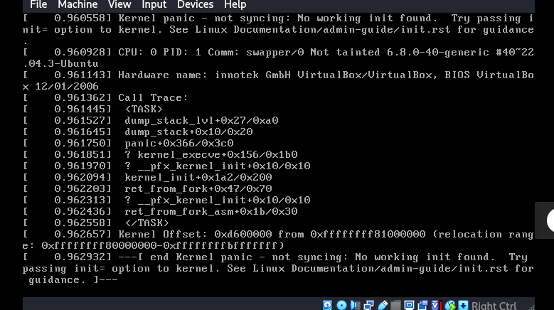

# pfSense Troubleshooting & Diagnostic Guide

## Overview

This guide lists common operational issues encountered during pfSense VirtualBox deployment, interface assignments, packet routing, DNS resolution, and their verified solutions.

---

## Troubleshooting Matrix

### Issue 1: Unable to Access pfSense WebGUI at `https://10.0.0.1`

* **Symptom**: Web browser timeout when accessing `https://10.0.0.1`.
* **Root Causes & Diagnostics**:
  1. Client VM is attached to incorrect VirtualBox Internal Network.
  2. Client VM IP address is outside `10.0.0.0/24`.
  3. Anti-lockout rule was accidentally removed from LAN interface.
* **Resolution**:
  1. Check VirtualBox VM network settings -> ensure Adapter is set to `Internal Network` -> `intnet-mgmt`.
  2. Inspect client IP: `ip a` or `ipconfig /all`. Request new DHCP lease (`dhclient` or `ipconfig /renew`).
  3. From pfSense console, run Option `11` (**Restart webConfigurator**) or Option `2` (**Set interface IP address**) to re-enable WebGUI and anti-lockout rule.

---

### Issue 2: WAN Interface Has No IP Address (`0.0.0.0` or Missing Gateway)

* **Symptom**: WAN shows `v4/DHCP: 0.0.0.0` on console or no default gateway.
* **Root Cause**: VirtualBox Adapter 1 NAT network driver disconnected or VirtualBox NAT network backend stalled.
* **Resolution**:
  1. Go to VirtualBox VM Settings -> Network -> Adapter 1 (NAT) -> Ensure **Cable Connected** checkbox is ticked.
  2. From pfSense console, open Shell (Option `8`) and run:
     ```bash
     dhclient em0
     ```

---

### Issue 3: No Outbound Internet Egress from Internal Subnets

* **Symptom**: Internal hosts can ping pfSense gateway `10.x.x.1`, but cannot ping `8.8.8.8` or reach external websites.
* **Root Cause**: An explicitly permitted segment lacks its required NAT rule, or the WAN gateway is down. Malware should never have WAN egress.
* **Resolution**:
  1. Log into WebGUI -> Navigate to **Status** -> **Gateways**. Confirm `WAN_DHCP` status is `Online`.
  2. Navigate to **Firewall** -> **NAT** -> **Outbound**. Check for a rule covering only the segment that is intended to reach WAN, and verify its interface firewall rules permit that traffic. Do not add a broad rule for all `10.0.0.0/8`; ensure MALWARE (`10.40.40.0/24`) has no WAN rule.

---

### Issue 4: Inter-VLAN Traffic Blocked Unintentionally

* **Symptom**: Host in Management cannot reach Active Directory DC `10.20.20.10`.
* **Root Cause**: Firewall rule ordering or missing state creation.
* **Resolution**:
  1. Inspect **Firewall** -> **Rules** -> **LAN**. Ensure pass rules for `Internal_Lab_Subnets` are located **ABOVE** any block rules.
  2. Inspect pfSense States: Go to **Diagnostics** -> **States**, search for target IP `10.20.20.10` and kill stale states.

---

### Issue 5: DNS Resolution Fails on Internal Hosts

* **Symptom**: Host can ping `1.1.1.1` by IP address, but `nslookup google.com` fails.
* **Root Cause**: Unbound DNS service stopped or interface binding restricted.
* **Resolution**:
  1. Go to **Services** -> **DNS Resolver**. Verify service status icon is green (Running).
  2. Under **Network Interfaces**, select only permitted interfaces. Exclude MALWARE; use a local fake-DNS service inside that segment instead.

---

### Issue 6: Physical Kali Cannot Reach a Lab Gateway

* **Symptom**: Kali can reach neither `10.0.0.1` nor other lab gateways through HOST_MGMT.
* **Root Causes & Diagnostics**: `vboxnet0` is missing/down, its address is wrong, pfSense HOST_MGMT is not assigned, or routes are absent/pointing elsewhere.
* **Resolution**:
  1. Confirm the Kali host has `192.168.56.1/24` on `vboxnet0` and can ping pfSense at `192.168.56.2`.
  2. Confirm the pfSense adapter is attached to `vboxnet0`, its interface has `192.168.56.2/24`, and no upstream gateway is set.
  3. Check `ip route get 10.30.30.10`; add the documented HOST_MGMT routes through `192.168.56.2` if needed. Do not attach Kali to `intnet-mgmt`.

---

### Issue 7: WireGuard Has No Recent Handshake

* **Symptom**: `sudo wg` shows no recent handshake from an external network.
* **Root Causes & Diagnostics**: A missing UDP port-forward in the home router or VirtualBox NAT, incorrect guest WAN IP, absent WAN UDP `51820` rule, or ISP CGNAT.
* **Resolution**:
  1. Verify the peer keys, endpoint, listen port, and pfSense tunnel status.
  2. Forward UDP `51820` from the upstream router (if present) to Kali, then from VirtualBox Adapter 1 host port `51820` to the pfSense WAN IP/port `51820`.
  3. On the isolated VirtualBox NAT WAN only, disable **Block private networks** if it prevents the forwarded handshake. Keep it enabled on public WANs.
  4. Test from a genuinely external connection. If the ISP uses CGNAT, use an outbound tunnel or public VPN endpoint.

---

### Issue 8: Client VM Kernel Panic on Boot (`Kernel panic - not syncing: No working init found`)



* **Symptom**: Client virtual machine (e.g. Linux guest) fails to boot, printing `Kernel panic - not syncing: No working init found. Try passing init= option to kernel.`
* **Root Cause**: Virtual disk image corruption, missing/corrupted initramfs image, or improper CPU/storage controller attachment in VirtualBox.
* **Resolution**:
  1. Boot into GRUB recovery mode or live ISO environment to reinstall/repair the initramfs (`update-initramfs -u -k all`).
  2. Verify VM storage controller settings in VirtualBox: ensure VDI/VMDK virtual disk is attached under AHCI (SATA) controller rather than IDE, and PAE/NX is enabled in VM CPU settings.

<!-- minimal update -->
